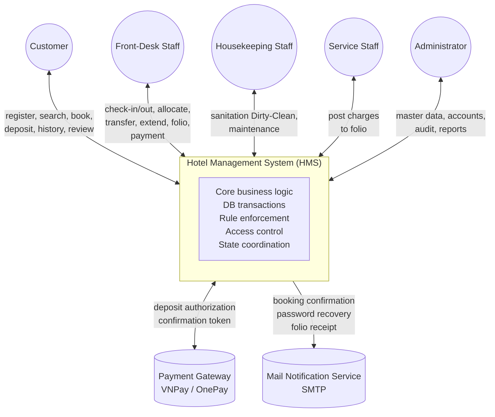
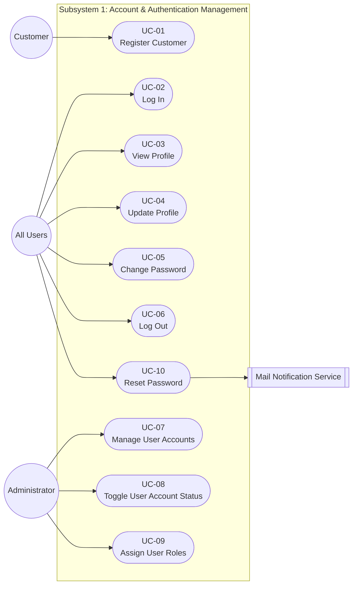
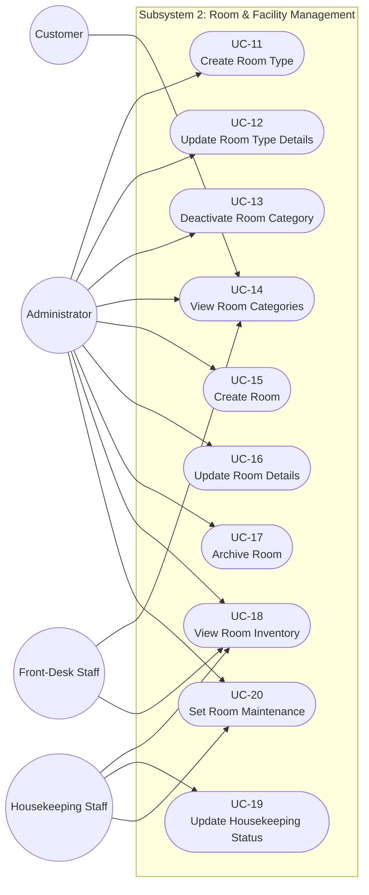
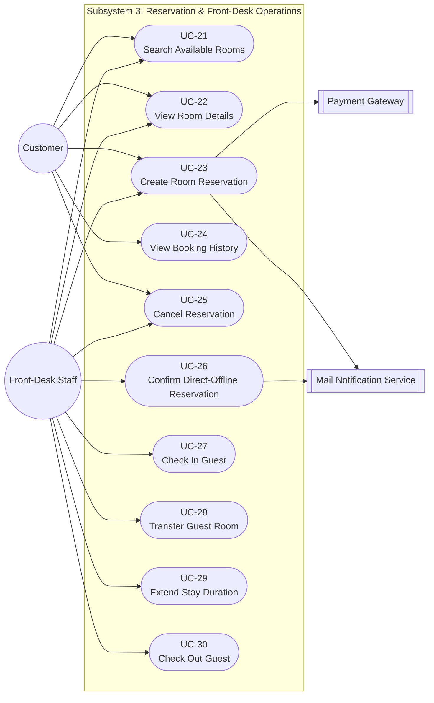
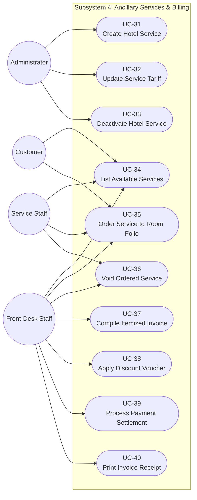
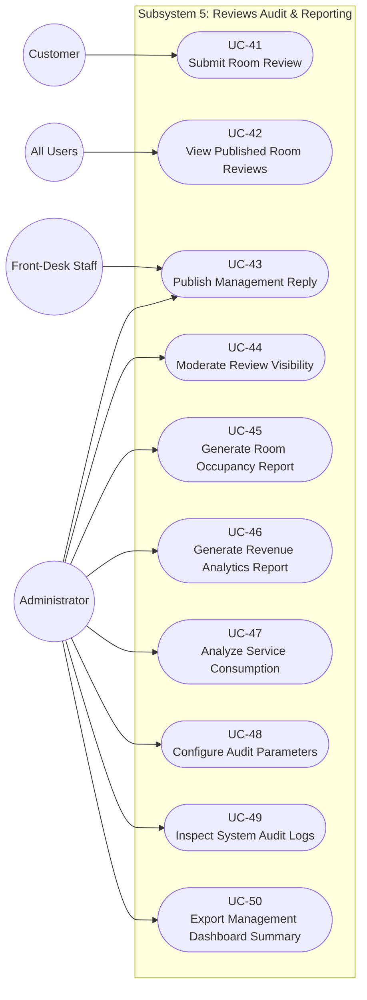
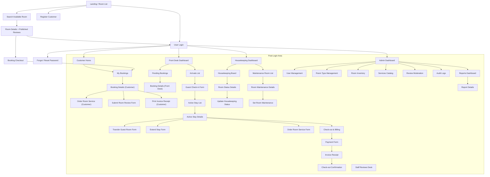
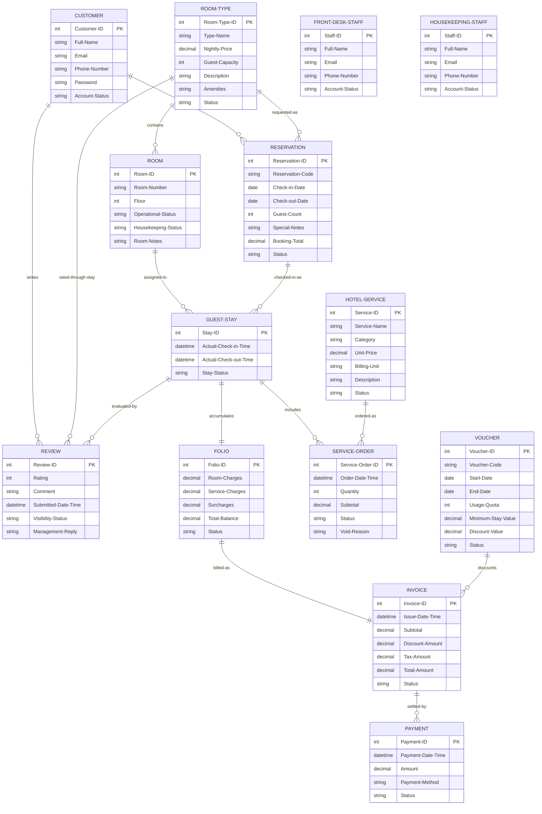

# Hotel Management System — Software Requirement Specification

> Chuyển từ `HMS_SoftwareRequirementSpecification.docx` (Project Code: HMS, Document Code: HMS-SRS – v1.2, Hanoi, October 2026).
>
> Quy ước chuyển đổi:
> - Giữ toàn bộ chữ và bảng trong DOCX.
> - **Sơ đồ vẽ lại bằng Mermaid** (overview, use-case 2-1..2-5, screens flow, ERD).
> - **Ảnh chụp màn hình / mock-up trong DOCX đã lược bỏ** (ghi chú tại từng Figure).

Project Code: HMS

Document Code: HMS-SRS– v1.2

– Hanoi, October 2026 –

## Table of Contents

_(Mục lục trong DOCX là tự động; dưới đây là mục lục rút gọn theo tiêu đề trong tài liệu.)_

- I. Record of Changes
- II. Software Requirement Specification
  - 1. Product Overview
  - 2. User Requirements
  - 3. Software Features (3.1 Functional Overview; 3.2 Booking Process; 3.3 Booking Confirmation & Check-in; 3.4 Active Guest Stay Management; 3.5 Checkout & Payment; 3.6 Housekeeping & Maintenance)
  - 4. Non-Functional Requirements
  - 5. Requirement Appendix

# I. Record of Changes

| Date | A* / M, D | In charge | Change Description |
| --- | --- | --- | --- |
| 25/09/2026 | A | KhangND | Add an overall description about the product with some introduction and the context diagram. |
| 25/09/2026 | A | KhangND | Add Actors và Use Cases Diagram, Use Case Description |
| 28/09/2026 | A | HieuVQ | Define Comprehensive Requirement Appendix (BR-01 to BR-42, Common Requirements, Messages List MSG01-MSG40, and Other Requirements). |
| 28/09/2026 | A | GiapND | Add the Screen Flow section |
| 28/09/2026 | A | GiapND | Add the screen description |
| 28/09/2026 | A | LinhNH | Add Non-Functional Requirement |
| 29/09/2026 | M | KhangND | Modify over description about the product and context diagram after revision. |
| 29/09/2026 | M | KhangND | Modify Use Cases diagram and Use Case Description |
| 30/09/2026 | M | GiapND | Revise the Screen Flow based on the updated use cases |
| 30/09/2026 | A | GiapND | Add Booking screen definitions, mockups, and use case descriptions. |
| 1/10/2026 | M | TungPV | Modify ERD |
| 01/10/2026 | A | HieuVQ | Add Housekeeping mockup, screen definitions, use case descriptions, business rule, common requirement, application message and other requirements. |
| 2/10 | M | KhangND | Update product overview and context diagram, modify some use cases in Use case description table and use case diagram |

*A - Added M - Modified D - Deleted

# II. Software Requirement Specification

## 1. Product Overview

The Hotel Management System (HMS) is a centralized web-based operational platform engineered to coordinate daily lodging activities across independent hospitality establishments. The system automates room inventory allocation, online reservation handling, guest reception logistics, room cleanliness tracking, ancillary service consumption, folio billing, financial reporting, and guest satisfaction reviews.

### 1.1 Organizational Context & Target Operational Profile

The software is designed for independent mid-scale boutique and commercial hotels (3-star to 4-star standard) operating with an inventory of 60 to 120 rooms and a staff base of 25 to 50 employees operating across flexible shifts.

The enterprise structure consists of four functional divisions:

Front Office, Sales & Marketing Division: Front desk staff handle reservations, verify identification, allocate clean rooms, issue physical keys, transfer rooms, and complete departures. Sales & Marketing staff configure room tariffs, promotional vouchers, and analyze occupancy trends.

Housekeeping Department: Floor staff track vacated rooms, clean rooms, update sanitation states (Dirty  Clean), and report equipment malfunctions for maintenance.

Food & Beverage (F&B) and Ancillary Services Department: Restaurant, minibar, spa, and laundry staff deliver guest requests and post service charges directly onto active room stay folios.

Finance & System Administration Department: Accountants review revenue ledgers and reconcile payments. The IT Administrator governs employee accounts, access permissions, security parameters, and system audit trails.

### 1.2 Core Business Process: The Complete Guest Stay Cycle

The system coordinates the guest journey through four stages:

Stage 1: Pre-Arrival & Reservation: Prospective guests search available rooms by dates and guest count. Creating a booking places it in Pending status and temporarily holds inventory. The guest pays a deposit through an external payment gateway, or the front desk verifies the reservation to transition it to Confirmed.

Stage 2: Arrival & Check-In: The guest arrives at the hotel. Receptionists verify legal identification, match the booking, assign a vacant room certified as Clean, hand over keys, and transition the booking to Checked-In and the room to Occupied.

Stage 3: In-House Stay & Service Consumption: During the stay, guests order room service, dining, minibar items, or laundry. Service staff record consumption directly into the guest's folio. Room transfers or stay extensions are processed based on downstream room vacancy. Housekeeping conducts routine cleaning and marks rooms as Clean.

Stage 4: Departure, Folio Settlement & Turnover: At checkout, housekeeping inspects the room for minibar usage or property damage and reports them to the front desk. Staff compile an itemized folio including room nights, ancillary services, surcharges, and voucher deductions. Once the balance is settled, staff complete the checkout, print an itemized invoice receipt, and the system sets the room to Dirty for housekeeping turnover. Guests may then submit an accommodation review.

> *[Sơ đồ gốc Figure 1-1 trong DOCX được vẽ lại bằng Mermaid bên dưới; ảnh gốc đã lược bỏ.]*

*Figure 1-1: Hotel Management System overview*

As described in the figure 1-1, the system will have the following components

Hotel Management System (HMS): The central software application boundary providing core business logic processing, database transactions, operational rule enforcement, access control validation, and state coordination across all operational departments.

Customer: An external end-user who accesses public services to register an account, search real-time room availability, initiate bookings, submit advance deposits, review stay history, and post verified feedback upon departure.

Front-Desk Staff: An internal operational actor executing front-office desk duties: processing guest arrivals and check-ins, allocating clean rooms, issuing key cards, handling mid-stay transfers and extensions, compiling stay folios, recording direct payments, and completing departure checkouts.

Housekeeping Staff: An internal operational actor managing floor hygiene: querying rooms requiring sanitation, toggling cleanliness statuses between Dirty and Clean, and placing defective rooms under maintenance.

Service Staff: An internal operational actor representing ancillary service departments (F&B, room service, minibar, spa, laundry) who delivers ordered items to rooms and posts consumption charges directly to the active guest folio.

Administrator: An internal managerial and technical authority responsible for configuring master property data (room types, base tariffs, service items, promotional vouchers), provisioning staff accounts and permissions, reviewing operational audit logs, and analyzing occupancy and revenue analytics.

Payment Gateway: An external third-party financial service (e.g., VNPay, OnePay) that receives electronic deposit authorization requests from the HMS, securely processes customer payments, and returns authenticated transaction confirmation tokens and payment statuses.

Mail Notification Service: An external automated mail transfer service (SMTP) that receives outbound email payloads from the HMS to dispatch transactional booking confirmations, password recovery verification tokens, and digital itemized folio receipts to recipients.

## 2. User Requirements

### 2.1 Actors

| # | Actor | Description |
| --- | --- | --- |
| 1 | Customer | An external guest who accesses public booking features: browsing room categories, registering an account, booking rooms, submitting online deposits, viewing personal stay histories, and authoring room reviews after departure. |
| 2 | Front-Desk Staff | A receptionist responsible for front-office operations: confirming pending bookings, conducting guest check-ins, allocating physical rooms, managing room transfers and extensions, compiling itemized folios, processing counter payments, and executing checkout departures. |
| 3 | Housekeeping Staff | A floor staff member or housekeeping supervisor responsible for room hygiene: monitoring dirty rooms, updating cleanliness progression (Dirty Clean), and reporting equipment malfunctions for maintenance lockouts. |
| 4 | Service Staff | An operational staff member representing ancillary amenities (F&B, minibar, spa, laundry): delivering services to in-house guests, posting auxiliary charges directly to active guest stay folios, and requesting cancellations for unrendered items. |
| 5 | Administrator | A general manager, accountant, or system administrator who configures room categories and tariffs, manages discount vouchers, controls user accounts and roles, inspects security audit logs, moderates customer reviews, and generates business analytical reports. |
| 6 | Payment Gateway | An external electronic payment processing entity that validates credit card or digital wallet transactions, processes online room reservation deposits, and returns transaction authorization codes. |
| 7 | Mail Notification Service | An external automated mail delivery system that receives system requests to dispatch transactional booking confirmations, password recovery verification codes, and digital itemized receipts. |

### 2.2 Use Cases

The system provides 50 use cases partitioned into five functional subsystems:

Subsystem 1: Account & Authentication Management (UC01 – UC10): Covers account registration, authentication, profile self-management, administrative user control, and password recovery.

Subsystem 2: Room & Facility Management (UC11 – UC20): Covers room category configuration, inventory setup, room browsing, housekeeping workflow, and maintenance tracking.

Subsystem 3: Reservation & Front-Desk Operations (UC21 – UC30): Covers room availability searches, booking lifecycles (creation, cancellation, confirmation), and front-desk execution (check-in, room move, extension, checkout).

Subsystem 4: Ancillary Services & Billing Management (UC31 – UC40): Covers the auxiliary service catalog, folio charge postings, voucher applications, payment collection, and invoice generation.

Subsystem 5: Reviews, Audit & Reporting Management (UC41 – UC50): Covers customer reviews, moderation, audit trail viewing, and managerial business reporting.

#### 2.2.1 Diagram(s)

> *[Sơ đồ use-case gốc trong DOCX được vẽ lại bằng Mermaid bên dưới; ảnh gốc đã lược bỏ.]*

*Figure 2-1: Subsystem 1 Use Case Diagram*

> *[Sơ đồ use-case gốc trong DOCX được vẽ lại bằng Mermaid bên dưới; ảnh gốc đã lược bỏ.]*

*Figure 2-2: Subsystem 2 Use Case Diagram*

> *[Sơ đồ use-case gốc trong DOCX được vẽ lại bằng Mermaid bên dưới; ảnh gốc đã lược bỏ.]*

*Figure 2-3: Subsystem 3 Use Case Diagram*

> *[Sơ đồ use-case gốc trong DOCX được vẽ lại bằng Mermaid bên dưới; ảnh gốc đã lược bỏ.]*

*Figure 2-4: Subsystem 4 Use Case Diagram*

> *[Sơ đồ use-case gốc trong DOCX được vẽ lại bằng Mermaid bên dưới; ảnh gốc đã lược bỏ.]*

*Figure 2-5: Subsystem 5 Use Case Diagram*

#### 2.2.2 Descriptions

| ID | Group Function | Use Case | Actors | Use Case Description & Main Flow |
| --- | --- | --- | --- | --- |
| UC-01 | Account & Authentication | Register Customer | Customer | Description: Allows an unauthenticated guest to create a personal customer account. / Main Flow: / 1. Customer accesses registration view. / 2. Customer inputs legal name, email, phone number, and password. / 3. System validates format and verifies email uniqueness. / 4. System creates customer account and displays confirmation. / Alternative Flow: / • Email Exists: System prompts error and suggests login. |
| UC-02 | Account & Authentication | Log In | All Users | Description: Authenticates credentials to grant system access to authorized modules. / Main Flow: / 1. User inputs registered email and password. / 2. System validates credentials and confirms account is Active. / 3. System establishes authenticated user session and redirects to role dashboard. / Alternative Flow: / • Invalid Credentials: System rejects login and displays error notification. |
| UC-03 | Account & Authentication | View Profile | All Users | Description: Displays the personal account profile of the currently logged-in user. / Main Flow: / 1. User accesses personal profile view. / 2. System retrieves profile attributes of the current session. / 3. System displays full name, email, phone number, and assigned role. |
| UC-04 | Account & Authentication | Update Profile | All Users | Description: Modifies personal user contact information. / Main Flow: / 1. User updates name or phone number on profile view. / 2. User confirms updates. / 3. System validates telephone format and commits changes. / 4. System acknowledges update success. / Alternative Flow: / • Invalid Format: System alerts invalid phone syntax and requires re-entry. |
| UC-05 | Account & Authentication | Change Password | All Users | Description: Updates account password for security maintenance. / Main Flow: / 1. User inputs current password, new password, and confirmation password. / 2. System validates current password correctness. / 3. System validates new password complexity rules. / 4. System saves updated credentials and confirms success. / Alternative Flow: / • Mismatch: System flags non-matching confirmation password. |
| UC-06 | Account & Authentication | Log Out | All Users | Description: Terminates the current authenticated user session. / Main Flow: / 1. User triggers logout command. / 2. System clears the active session context. / 3. System redirects user to the public landing page. |
| UC-07 | Account & Authentication | Manage User Accounts | Administrator | Description: Provides administrative retrieval, search, and filtering of all user accounts. / Main Flow: / 1. Administrator accesses user governance view. / 2. System loads account records with filters. / 3. Administrator filters users by name, role, or active status. / 4. System refreshes display table with matching records. |
| UC-08 | Account & Authentication | Toggle User Account Status | Administrator | Description: Activates or deactivates user accounts to govern access. / Main Flow: / 1. Administrator selects target user account. / 2. Administrator changes status (Active/Inactive). / 3. System verifies administrator is not deactivating self. / 4. System commits status and immediately revokes active tokens for inactive accounts. |
| UC-09 | Account & Authentication | Assign User Roles | Administrator | Description: Updates employee access permissions across staff roles. / Main Flow: / 1. Administrator selects employee account. / 2. Administrator selects new role (Front-Desk Staff, Housekeeping Staff, Service Staff, Administrator). / 3. System validates authority, commits new role, and logs administrative action. / 4. System displays confirmation message. |
| UC-10 | Account & Authentication | Reset Password | All Users, Mail Notification Service | Description: Recovers account access via time-limited verification email. / Main Flow: / 1. User inputs registered email on recovery screen. / 2. System validates email existence and creates time-limited token. / 3. System requests Mail Notification Service to dispatch reset email. / 4. User accesses link, provides new password, and system updates credentials. / Alternative Flow: / • Expired Token: System informs user link expired and prompts new request. |
| UC-11 | Room & Facility Management | Create Room Type | Administrator | Description: Configures a new accommodation category (e.g., Deluxe, Suite). / Main Flow: / 1. Administrator opens category creation form. / 2. Administrator inputs category title, standard base rate, guest capacity, and amenities list. / 3. System validates uniqueness and confirms positive rate. / 4. System adds category to active catalog. |
| UC-12 | Room & Facility Management | Update Room Type Details | Administrator | Description: Adjusts rates, capacities, or descriptions of an existing room tier. / Main Flow: / 1. Administrator selects an existing room category. / 2. Administrator edits base nightly price, guest capacity, or amenity tags. / 3. System validates inputs and updates the category record. / 4. System acknowledges modification. |
| UC-13 | Room & Facility Management | Deactivate Room Category | Administrator | Description: Decommissions a room category from the active catalog. / Main Flow: / 1. Administrator selects room category to decommission. / 2. System verifies no active physical rooms are assigned to this category. / 3. System sets category to inactive, preventing future bookings while retaining historical data. |
| UC-14 | Room & Facility Management | View Room Categories | Customer, Front-Desk Staff, Administrator | Description: Displays public catalog of accommodation categories and descriptions. / Main Flow: / 1. User navigates to accommodations view. / 2. System retrieves all active room categories. / 3. System displays category cards detailing photos, descriptions, capacities, and base rates. |
| UC-15 | Room & Facility Management | Create Room | Administrator | Description: Registers an individual physical room unit into inventory. / Main Flow: / 1. Administrator inputs room door number, floor index, and selects room category. / 2. System validates room number uniqueness across the property. / 3. System saves room with occupancy status Vacant and cleanliness Clean. |
| UC-16 | Room & Facility Management | Update Room Details | Administrator | Description: Modifies physical room attributes, floor location, or notes. / Main Flow: / 1. Administrator selects target room record. / 2. Administrator updates floor index, category association, or notes. / 3. System commits updates and refreshes inventory display. |
| UC-17 | Room & Facility Management | Archive Room | Administrator | Description: Retires an unusable room unit from active operational inventory. / Main Flow: / 1. Administrator selects room to archive. / 2. System verifies room is vacant with no active or future bookings. / 3. System flags room as archived, removing it from scheduling. / Alternative Flow: / • Room Occupied: System rejects archival and displays error message. |
| UC-18 | Room & Facility Management | View Room Inventory | Front-Desk Staff, Housekeeping Staff, Administrator | Description: Displays operational table of all hotel rooms with multi-status filters. / Main Flow: / 1. Staff opens room inventory dashboard. / 2. Staff applies filters by floor, category, occupancy status, or cleanliness status. / 3. System retrieves and displays matching room records. |
| UC-19 | Room & Facility Management | Update Housekeeping Status | Housekeeping Staff | Description: Updates room hygiene progression between Dirty and Clean. / Main Flow: / 1. Housekeeping staff accesses housekeeping board. / 2. Staff selects a dirty room that has been thoroughly sanitized. / 3. Staff sets status to Clean. / 4. System updates room hygiene state, signaling readiness to the front desk. |
| UC-20 | Room & Facility Management | Set Room Maintenance | Housekeeping Staff, Administrator | Description: Locks an out-of-order room for physical repairs, preventing reservations. / Main Flow: / 1. Staff identifies an equipment fault and selects target room. / 2. Staff inputs defect description and estimated repair completion date. / 3. System sets room status to Under Maintenance and locks room availability. |
| UC-21 | Reservation & Front-Desk | Search Available Rooms | Customer, Front-Desk Staff | Description: Discovers unoccupied rooms meeting specified dates and guest counts. / Main Flow: / 1. User inputs check-in date, check-out date, and guest counts. / 2. System validates date logic (departure after arrival; arrival not in past). / 3. System scans inventory, excluding booked, occupied, and maintenance units. / 4. System displays eligible vacant room types and estimated totals. / Alternative Flow: / • No Vacancy: System notifies user that no rooms match and suggests alternative dates. |
| UC-22 | Reservation & Front-Desk | View Room Details | Customer, Front-Desk Staff | Description: Displays specifications, photos, amenities, and reviews for a selected room type. / Main Flow: / 1. User selects a room type card. / 2. System retrieves photo galleries, bed layouts, amenity checklists, rates, and verified reviews. / 3. System renders detailed view. |
| UC-23 | Reservation & Front-Desk | Create Room Reservation | Customer, Front-Desk Staff, Payment Gateway, Mail Notification Service | Description: Reserves advance accommodations online with mandatory pre-payment. / Main Flow: / 1. User selects stay dates, room type, guest count, and inputs contact info. / 2. System computes total stay price and reserves room quota. / 3. Customer authorizes full stay payment/deposit via Payment Gateway. / 4. Gateway confirms successful payment; system records transaction and marks booking as Confirmed. / 5. System requests Mail Notification Service to dispatch booking confirmation email with reference code. / Alternative Flow: / • Payment Failed: System releases reserved quota and alerts customer of payment rejection. |
| UC-24 | Reservation & Front-Desk | View Booking History | Customer | Description: Allows authenticated customer to inspect past, active, and pending bookings. / Main Flow: / 1. Customer navigates to "My Bookings". / 2. System loads reservations linked to customer account. / 3. System displays booking cards detailing stay dates, room types, status badges, and folios. |
| UC-25 | Reservation & Front-Desk | Cancel Reservation | Customer, Front-Desk Staff | Description: Cancels an unfulfilled booking and calculates applicable penalty fees. / Main Flow: / 1. User selects active reservation and initiates cancellation. / 2. System evaluates remaining hours before check-in against cancellation rules. / 3. System displays applicable penalty terms. / 4. User confirms cancellation; system sets status to Cancelled and releases inventory. / Alternative Flow: / • In-House Stay: System blocks online cancellation if booking is already checked in. |
| UC-26 | Reservation & Front-Desk | Confirm Direct / Offline Reservation | Front-Desk Staff, Mail Notification Service | Description: Records and confirms direct bookings created via telephone, corporate contracts, or front desk walk-ins. / Main Flow: / 1. Staff inputs customer contact details, dates, and selected room category. / 2. Staff verifies direct guarantee deposit (cash, bank transfer, or corporate billing). / 3. Staff confirms reservation; system sets booking status to Confirmed and deducts category inventory quota. / 4. System requests Mail Notification Service to send booking confirmation email to the guest. / Alternative Flow: / • No Inventory: System alerts staff that category is fully committed for requested dates. |
| UC-27 | Reservation & Front-Desk | Check In Guest | Front-Desk Staff | Description: Processes guest arrival, records legal identity, assigns a physical clean room unit, and delivers keys. / Main Flow: / 1. Staff retrieves confirmed booking by code, phone number, or guest name. / 2. Staff inspects and records guest national identification (ID/Passport). / 3. System displays available vacant physical rooms of booked tier having Clean status. / 4. Staff selects and assigns a specific physical room number (e.g., Room 302). / 5. Staff applies early arrival surcharge if check-in is before standard 14:00 time. / 6. Staff confirms check-in; system updates booking status to Checked-In, marks assigned room as Occupied, and staff issues physical key card. / Alternative Flow: / • No Clean Room Available: System prevents check-in and alerts staff to contact housekeeping for expedited cleaning. |
| UC-28 | Reservation & Front-Desk | Transfer Guest Room | Front-Desk Staff | Description: Reallocates an in-house guest to an alternative physical room during stay. / Main Flow: / 1. Staff opens active guest stay folio and initiates room move. / 2. Staff selects a new vacant Clean room and records transfer reason. / 3. System recalculates folio rate adjustments: upgrades append charges; downgrades due to hotel facility faults post credit balance. / 4. System assigns new room, frees previous room (marking it Dirty), and updates folio. |
| UC-29 | Reservation & Front-Desk | Extend Stay Duration | Front-Desk Staff | Description: Postpones the scheduled departure date for a resident guest. / Main Flow: / 1. Staff inputs requested new departure date. / 2. System verifies assigned room is vacant for all extended nights. / 3. System calculates additional room charges and appends them to folio. / 4. System updates departure date. / Alternative Flow: / • Room Conflict: System alerts staff of conflict and suggests room transfer. |
| UC-30 | Reservation & Front-Desk | Check Out Guest | Front-Desk Staff | Description: Finalizes guest departure, closes billing folios, and releases physical room. / Main Flow: / 1. Staff opens departure folio and confirms key return. / 2. System verifies outstanding folio balance is zero. / 3. Staff confirms checkout. / 4. System updates booking to Completed and marks room as Dirty for turnover. / Alternative Flow: / • Unsettled Balance: System blocks checkout completion until balance is paid in full. |
| UC-31 | Services & Billing | Create Hotel Service | Administrator | Description: Defines an ancillary hospitality service (e.g., Laundry, Buffet, Spa). / Main Flow: / 1. Administrator enters service title, unit price, category, and billing unit. / 2. System verifies title uniqueness within category. / 3. System registers service item into active catalog. |
| UC-32 | Services & Billing | Update Service Tariff | Administrator | Description: Updates the pricing structure of an existing ancillary service. / Main Flow: / 1. Administrator selects target service item. / 2. Administrator updates unit rate. / 3. System validates positive pricing and saves changes, applying solely to future orders. |
| UC-33 | Services & Billing | Deactivate Hotel Service | Administrator | Description: Deprecates an auxiliary service from the active ordering menu. / Main Flow: / 1. Administrator selects service item to discontinue. / 2. System flags service as inactive, preventing new orders while preserving past order records. |
| UC-34 | Services & Billing | List Available Services | Customer, Front-Desk Staff, Service Staff | Description: Displays active ancillary hotel services and current price schedules. / Main Flow: / 1. User navigates to services menu. / 2. System retrieves active service items grouped by category. / 3. System displays services, descriptions, and unit prices. |
| UC-35 | Services & Billing | Order Service to Room Folio | Customer, Front-Desk Staff, Service Staff | Description: Appends consumed auxiliary items directly onto active guest stay folio. / Main Flow: / 1. Actor (Customer via portal or Service/Front-Desk Staff) selects active room, items, and quantities. / 2. System verifies booking status is Checked-In. / 3. System computes item subtotals and posts charges directly to guest folio. / Alternative Flow: / • Not Checked In: System rejects posting if room is vacant or checked out. |
| UC-36 | Services & Billing | Void Ordered Service | Front-Desk Staff, Service Staff | Description: Voids mistakenly posted service charges before delivery. / Main Flow: / 1. Staff opens active stay folio. / 2. Staff selects unrendered service line item and enters void reason. / 3. System removes charge, recalculates folio balance, and logs void action. |
| UC-37 | Services & Billing | Compile Itemized Invoice | Front-Desk Staff | Description: Compiles room charges, services, surcharges, and discounts into an invoice. / Main Flow: / 1. Staff initiates invoice compilation for departure booking. / 2. System aggregates: (Room Nights Rate) + Service Charges + Surcharges. / 3. System generates an itemized invoice record under status Unpaid. |
| UC-38 | Services & Billing | Apply Discount Voucher | Front-Desk Staff | Description: Applies a promotional code or corporate discount to an invoice. / Main Flow: / 1. Staff inputs voucher code into invoice form. / 2. System verifies voucher active dates, usage quota, and minimum spend criteria. / 3. System recalculates invoice total, deducting promotional discount. / Alternative Flow: / • Invalid/Expired Code: System alerts staff of invalid voucher and maintains original balance. |
| UC-39 | Services & Billing | Process Payment Settlement | Front-Desk Staff | Description: Records monetary collection across supported tender methods (Cash, Card, Transfer). / Main Flow: / 1. Staff selects payment tender method and inputs received amount. / 2. System checks that received amount matches balance due. / 3. System marks invoice as Paid and generates payment confirmation. / Alternative Flow: / • Partial Payment: System records partial payment and updates remaining balance due. |
| UC-40 | Services & Billing | Print Invoice Receipt | Front-Desk Staff | Description: Formats and prints an official itemized payment receipt for the guest. / Main Flow: / 1. Front-desk staff triggers print receipt action. / 2. System formats document with hotel corporate header, booking code, itemized breakdown, and payment stamp. / 3. System renders printable invoice view. |
| UC-41 | Reviews, Audit & Reporting | Submit Room Review | Customer | Description: Allows verified guests to submit star ratings and written feedback after departure. / Main Flow: / 1. Customer selects a completed reservation. / 2. System verifies booking status is Completed and review has not been submitted previously. / 3. Customer inputs star rating (1–5) and comments. / 4. System saves review and updates average room category rating. / Alternative Flow: / • Duplicate Review: System blocks submission if review was already submitted for this stay. |
| UC-42 | Reviews, Audit & Reporting | View Published Room Reviews | All Users | Description: Displays historical verified guest feedback and management responses. / Main Flow: / 1. User navigates to reviews section of a room category. / 2. System retrieves verified, non-hidden reviews for that category. / 3. System renders average rating, guest comments, and management replies. |
| UC-43 | Reviews, Audit & Reporting | Publish Management Reply | Front-Desk Staff, Administrator | Description: Allows hotel management or front office supervisor to post an official public response to a review. / Main Flow: / 1. Staff selects a customer review. / 2. Staff writes an official management reply. / 3. System publishes reply underneath customer review. / Alternative Flow: / • Duplicate Reply: System prompts editing existing reply instead of duplicate posting. |
| UC-44 | Reviews, Audit & Reporting | Moderate Review Visibility | Administrator | Description: Hides inappropriate or defamatory customer reviews from public display. / Main Flow: / 1. Administrator identifies a review violating content standards. / 2. Administrator executes hide review action. / 3. System flags review as hidden, excluding it from public view and rating calculations. |
| UC-45 | Reviews, Audit & Reporting | Generate Room Occupancy Report | Administrator | Description: Calculates and visualizes hotel room occupancy percentages over a selected period. / Main Flow: / 1. Administrator specifies start and end dates. / 2. System computes: $(\text{Occupied Room Nights} / \text{Available Room Nights}) \times 100\%$. / 3. System displays occupancy distribution chart and statistics. / Alternative Flow: / • Invalid Range: System alerts administrator if start date is after end date. |
| UC-46 | Reviews, Audit & Reporting | Generate Revenue Analytics Report | Administrator | Description: Compiles financial revenue segmented by room tariffs and ancillary services. / Main Flow: / 1. Administrator selects reporting interval (daily, monthly, quarterly). / 2. System aggregates settled payments from paid invoices. / 3. System displays revenue trend charts and breakdown figures. |
| UC-47 | Reviews, Audit & Reporting | Analyze Service Consumption | Administrator | Description: Ranks auxiliary hotel services by usage volume and total sales. / Main Flow: / 1. Administrator accesses service analytics view. / 2. System aggregates historical service orders within the selected date range. / 3. System displays ranked table of consumed services sorted by sales volume. |
| UC-48 | Reviews, Audit & Reporting | Configure Audit Parameters | Administrator | Description: Configures retention periods and tracking rules for sensitive operations. / Main Flow: / 1. Administrator accesses audit governance console. / 2. Administrator defines critical operations subject to audit tracking and retention policy. / 3. System saves audit parameters and applies logging rules to transactions. |
| UC-49 | Reviews, Audit & Reporting | Inspect System Audit Logs | Administrator | Description: Enables administrative review of operational audit records for accountability. / Main Flow: / 1. Administrator accesses audit log viewer. / 2. Administrator filters records by actor, action category, or date range. / 3. System displays chronological audit entries with operator identity and activity details. |
| UC-50 | Reviews, Audit & Reporting | Export Management Dashboard Summary | Administrator | Description: Exports operational and financial performance summaries to spreadsheet files. / Main Flow: / 1. Administrator initiates report export action. / 2. System aggregates occupancy metrics, revenue figures, net bookings, and service sales. / 3. System generates and downloads formatted summary spreadsheet. |

## 3. Software Features

### 3.1 Functional Overview

The Hotel Management System is described through its screen flow, screen descriptions, user roles, screen authorization, non-screen functions, and entity relationships. These components define how users interact with the system, which functions each role can access, background system functions, and the main data entities used by HMS.

#### 3.1.1 Screens Flow

> *[Sơ đồ Screen Flow gốc trong DOCX được vẽ lại bằng Mermaid bên dưới; ảnh gốc đã lược bỏ.]*

**Screen Flow Notation** (ảnh sơ đồ gốc đã lược bỏ, vẽ lại bằng Mermaid bên dưới)

**Chú giải ký hiệu (giữ nguyên từ DOCX):**

Rectangle: Represents a system screen, form, or view.

Oval: Represents a system action or confirmation step.

Arrow: Represents the navigation or transition between screens.

Post-Login Area: Represents functions that are available only to authenticated users.

#### 3.1.2 Screen Descriptions

| # | Feature | Screen | Description |
| --- | --- | --- | --- |
| 1 | Authentication | User Login | Allows users to log in to the system. |
| 2 | Authentication | Forgot / Reset Password | Allows users to reset a forgotten password. |
| 3 | Authentication | Register Customer | Allows customers to register a new account. |
| 4 | User Profile | User Profile | Displays the current user's profile information. |
| 5 | User Profile | Update Profile | Allows users to update their profile information. |
| 6 | User Profile | Change Password | Allows users to change their password. |
| 7 | Room Search | Room List | Displays the list of rooms. |
| 8 | Room Search | Search Available Room | Allows users to search for available rooms. |
| 9 | Room Search | Room Details | Displays detailed information about a selected room. |
| 10 | Reviews | Published Room Reviews | Displays published room reviews. |
| 11 | Customer | Customer Home | Provides access to functions available to authenticated customers. |
| 12 | Booking | Booking Checkout | Allows customers to complete a room booking. |
| 13 | Booking | My Bookings | Displays the customer's bookings. |
| 14 | Booking | Booking Details | Displays detailed information about a selected booking. |
| 15 | Reviews | Submit Room Review Form | Allows customers to submit a room review. |
| 16 | Billing | Print Invoice Receipt | Displays the invoice receipt for viewing or printing. |
| 17 | Room Service | Order Room Service | Allows customers to request room services. |
| 18 | Front Desk | Front Desk Dashboard | Provides access to front-desk operations. |
| 19 | Booking | Pending Bookings | Displays bookings waiting for processing. |
| 20 | Check-in | Arrivals List | Displays bookings scheduled for guest arrival. |
| 21 | Check-in | Guest Check-in Form | Allows front-desk staff to perform guest check-in. |
| 22 | Stay Management | Active Stay List | Displays current guest stays. |
| 23 | Stay Management | Active Stay Details | Displays detailed information about an active stay. |
| 24 | Stay Management | Transfer Guest Room Form | Allows staff to transfer a guest to another room. |
| 25 | Stay Management | Extend Stay Form | Allows staff to extend a guest's stay. |
| 26 | Room Service | Order Room Service Form | Allows staff to manage room service requests for an active stay. |
| 27 | Billing | Check-out & Billing | Displays booking charges and supports the check-out process. |
| 28 | Payment | Payment Form | Allows staff to record a payment. |
| 29 | Billing | Invoice Receipt | Displays invoice and payment information. |
| 30 | Reviews | Staff Reviews Desk | Displays customer reviews for staff handling. |
| 31 | Reviews | Review Details | Displays detailed information about a selected review. |
| 32 | Reviews | Publish Management Reply | Allows staff to submit a reply to a customer review. |
| 33 | Housekeeping | Housekeeping Dashboard | Provides access to housekeeping functions. |
| 34 | Housekeeping | Housekeeping Board | Displays rooms and their housekeeping status. |
| 35 | Housekeeping | Room Status Details | Displays detailed housekeeping status of a room. |
| 36 | Housekeeping | Update Housekeeping Status | Allows staff to update a room's housekeeping status. |
| 37 | Maintenance | Maintenance Room List | Displays rooms related to maintenance activities. |
| 38 | Maintenance | Room Maintenance Details | Displays maintenance information for a selected room. |
| 39 | Administration | Admin Dashboard | Provides access to administrative functions. |
| 40 | User Management | User Management | Displays user accounts for administration. |
| 41 | User Management | User Details | Displays detailed information about a selected user. |
| 42 | Room Type Management | Room Type Management | Displays room types for administration. |
| 43 | Room Type Management | Room Type Details | Displays detailed information about a selected room type. |
| 44 | Room Management | Room Inventory | Displays the hotel's physical room inventory. |
| 45 | Service Management | Services Catalog | Displays hotel services for administration. |
| 46 | Service Management | Service Details | Displays detailed information about a selected service. |
| 47 | Review Management | Review Moderation | Displays reviews for administrative moderation. |
| 48 | Audit Management | Audit Logs | Displays recorded system audit logs. |
| 49 | Audit Management | Audit Log Details | Displays detailed information about a selected audit log. |
| 50 | Reporting | Reports Dashboard | Provides access to available hotel reports. |
| 51 | Reporting | Report Details | Displays detailed information about a selected report. |

#### 3.1.3 Screen Authorization

| # | Screen / Function | Guest / Public | Customer | Front-Desk Staff | Housekeeping Staff | Administrator |
| --- | --- | --- | --- | --- | --- | --- |
| 1 | User Login | X | X | X | X | X |
| 1.1 | Forgot / Reset Password | X | X | X | X | X |
| 1.2 | Register Customer | X |   |   |   |   |
| 2 | User Profile |   | X | X | X | X |
| 2.1 | Update Profile |   | X | X | X | X |
| 2.2 | Change Password |   | X | X | X | X |
| 3 | Room List | X | X | X | X | X |
| 4 | Search Available Room | X | X | X |   |   |
| 5 | Room Details | X | X | X |   |   |
| 5.1 | Published Room Reviews | X | X | X |   | X |
| 6 | Customer Home |   | X |   |   |   |
| 7 | Booking Checkout |   | X | X |   |   |
| 8 | My Bookings |   | X |   |   |   |
| 9 | Booking Details (Customer) |   | X |   |   |   |
| 9.1 | Cancel Booking |   | X |   |   |   |
| 9.2 | Submit Room Review Form |   | X |   |   |   |
| 9.3 | Print Invoice Receipt |   | X |   |   |   |
| 9.4 | Order Room Service |   | X |   |   |   |
| 10 | Front Desk Dashboard |   |   | X |   |   |
| 11 | Pending Bookings |   |   | X |   |   |
| 12 | Arrivals List |   |   | X |   |   |
| 13 | Booking Details (Front Desk) |   |   | X |   |   |
| 13.1 | Confirm Booking |   |   | X |   |   |
| 13.2 | Cancel Booking |   |   | X |   |   |
| 13.3 | Guest Check-in Form |   |   | X |   |   |
| 14 | Active Stay List |   |   | X |   |   |
| 15 | Active Stay Details |   |   | X |   |   |
| 15.1 | Transfer Guest Room Form |   |   | X |   |   |
| 15.2 | Extend Stay Form |   |   | X |   |   |
| 15.3 | Order Room Service Form |   |   | X |   |   |
| 15.4 | Check-out & Billing |   |   | X |   |   |
| 15.5 | Payment Form |   |   | X |   |   |
| 15.6 | Invoice Receipt |   | X | X |   |   |
| 15.7 | Check-out Confirmation |   |   | X |   |   |
| 16 | Staff Reviews Desk |   |   | X |   |   |
| 16.1 | Review Details |   |   | X |   |   |
| 16.2 | Publish Management Reply |   |   | X |   |   |
| 17 | Housekeeping Dashboard |   |   |   | X |   |
| 18 | Housekeeping Board |   |   |   | X |   |
| 18.1 | Room Status Details |   |   |   | X |   |
| 18.2 | Update Housekeeping Status |   |   |   | X |   |
| 19 | Maintenance Room List |   |   |   | X | X |
| 19.1 | Room Maintenance Details |   |   |   | X | X |
| 19.2 | Set Room Maintenance |   |   |   | X | X |
| 20 | Admin Dashboard |   |   |   |   | X |
| 21 | User Management |   |   |   |   | X |
| 21.1 | User Details |   |   |   |   | X |
| 21.2 | Toggle Status |   |   |   |   | X |
| 21.3 | Assign Role |   |   |   |   | X |
| 22 | Room Type Management |   |   |   |   | X |
| 22.1 | Room Type Details |   |   |   |   | X |
| 23 | Room Inventory |   |   | X | X | X |
| 24 | Services Catalog |   |   |   |   | X |
| 24.1 | Service Details |   |   |   |   | X |
| 25 | Review Moderation |   |   |   |   | X |
| 25.1 | Review Details |   |   |   |   | X |
| 26 | Audit Logs |   |   |   |   | X |
| 26.1 | Audit Log Details |   |   |   |   | X |
| 27 | Reports Dashboard |   |   |   |   | X |
| 27.1 | Report Details |   |   |   |   | X |

#### 3.1.4 Non-Screen Functions

| # | Feature | System Function | Description |
| --- | --- | --- | --- |
| 1 | Account & Authentication | Authentication Service | Validates user credentials and account status before granting access. |
| 2 | Account & Authentication | Password Reset Service | Generates a reset link and requests the mail service to send it to the user. |
| 3 | Reservation & Front-Desk | Room Availability Service | Checks room availability for the requested stay period. |
| 4 | Reservation & Front-Desk | Booking Reference Generation | Generates a unique reference code for a new reservation. |
| 5 | Reservation & Front-Desk | Booking Notification Service | Send a confirmation email after a reservation is confirmed. |
| 6 | Services & Billing | Invoice Calculation Service | Calculates room charges, service charges, discounts, and invoice total. |
| 7 | Reviews, Audit & Reporting | Audit Logging Service | Records system activities that require audit tracking. |
| 8 | Reviews, Audit & Reporting | Report Processing Service | Calculates report data for occupancy, revenue, and service consumption. |
| 9 | Reviews, Audit & Reporting | Report Export Service | Generates a spreadsheet file containing management report data. |

#### 3.1.5 Entity Relationship Diagram

> *[Sơ đồ ERD gốc trong DOCX được vẽ lại bằng Mermaid bên dưới; ảnh gốc đã lược bỏ.]*

**Entities Description** (sơ đồ ERD gốc đã lược bỏ ảnh, vẽ lại bằng Mermaid bên dưới)

| # | Entity | Description |
| --- | --- | --- |
| 1 | Customer | Represents a hotel guest who can make room reservations, place service orders, and submit reviews after completing a stay. |
| 2 | Front-Desk Staff | Represents hotel reception staff responsible for processing reservations and managing guest stays, including confirmation, check-in, room transfer, stay extension, billing, and check-out activities. |
| 3 | Housekeeping Staff | Represents hotel staff responsible for maintaining guest rooms and updating their housekeeping or maintenance status. |
| 4 | Room Type | Represents a category of accommodation offered by the hotel, defining the type of room requested during reservation, such as Deluxe or Suite. |
| 5 | Room | Represents an individual physical room in the hotel that belongs to a room type and can be assigned to guests during their stays. |
| 6 | Reservation | Represents an advance booking made for a customer, containing the requested room type and planned stay information before guest check-in. |
| 7 | Guest Stay | Represents the actual period of accommodation that results from an eligible reservation after the guest checks in, including the physical room or rooms occupied during the stay. |
| 8 | Hotel Service | Represents an ancillary service offered by the hotel, such as laundry, breakfast, spa, or airport transportation, that can be ordered during a guest stay. |
| 9 | Service Order | Represents a record of hotel services ordered for an active guest stay, including the selected service items to be charged to the guest. |
| 10 | Folio | Represents the financial record of an active guest stay, accumulating room charges, service charges, surcharges, discounts, and other amounts incurred before final billing. |
| 11 | Invoice | Represents the itemized bill generated from a guest folio, summarizing the charges, applicable discounts, taxes, and final amount payable by the guest. |
| 12 | Voucher | Represents a valid promotional or corporate discount that may be applied to an eligible invoice to reduce its payable amount according to defined conditions. |
| 13 | Payment | Represents a monetary settlement recorded against an invoice using a supported payment method, such as cash, card, or bank transfer. |
| 14 | Review | Represents a rating and written feedback submitted by a customer based on a completed guest stay. |

#### 3.1.6 Entity Details

Customer

| # | Attribute name | PK | Type | Mandatory | Description |
| --- | --- | --- | --- | --- | --- |
| 1 | Customer ID | x | Integer | Yes | Uniquely identifies a customer. |
| 2 | Full Name |   | String | Yes | Stores the customer's full legal name. |
| 3 | Email |   | String | Yes | Stores the customer's registered email address. |
| 4 | Phone Number |   | String | Yes | Stores the customer's contact telephone number. |
| 5 | Password |   | String | Yes | Stores the customer's account authentication credential. |
| 6 | Account Status |   | String | Yes | Indicates whether the customer account is active or inactive. |

Front-Desk Staff

| # | Attribute name | PK | Type | Mandatory | Description |
| --- | --- | --- | --- | --- | --- |
| 1 | Staff ID | x | Integer | Yes | Uniquely identifies a front-desk staff member. |
| 2 | Full Name |   | String | Yes | Stores the staff member's full name. |
| 3 | Email |   | String | Yes | Stores the staff member's registered email address. |
| 4 | Phone Number |   | String | No | Stores the staff member's contact telephone number. |
| 5 | Account Status |   | String | Yes | Indicates whether the staff account is active or inactive. |

Housekeeping Staff

| # | Attribute name | PK | Type | Mandatory | Description |
| --- | --- | --- | --- | --- | --- |
| 1 | Staff ID | x | Integer | Yes | Uniquely identifies a housekeeping staff member. |
| 2 | Full Name |   | String | Yes | Stores the staff member's full name. |
| 3 | Email |   | String | Yes | Stores the staff member's registered email address. |
| 4 | Phone Number |   | String | No | Stores the staff member's contact telephone number. |
| 5 | Account Status |   | String | Yes | Indicates whether the staff account is active or inactive. |

Room Type

| # | Attribute name | PK | Type | Mandatory | Description |
| --- | --- | --- | --- | --- | --- |
| 1 | Room Type ID | x | Integer | Yes | Uniquely identifies a room type. |
| 2 | Type Name |   | String | Yes | Stores the room category name, such as Deluxe or Suite. |
| 3 | Nightly Price |   | Decimal | Yes | Stores the standard nightly rate. |
| 4 | Guest Capacity |   | Integer | Yes | Specifies the maximum number of guests. |
| 5 | Description |   | String | No | Describes the room type. |
| 6 | Amenities |   | String | No | Describes amenities provided by the room type. |
| 7 | Status |   | String | Yes | Indicates whether the room type is active. |

Room

| # | Attribute name | PK | Type | Mandatory | Description |
| --- | --- | --- | --- | --- | --- |
| 1 | Room ID | x | Integer | Yes | Uniquely identifies a physical hotel room. |
| 2 | Room Number |   | String | Yes | Stores the unique room door number. |
| 3 | Floor |   | Integer | Yes | Specifies the floor on which the room is located. |
| 4 | Operational Status |   | String | Yes | Indicates whether the room is Available, Occupied, or under Maintenance. |
| 5 | Housekeeping Status |   | String | Yes | Indicates the room sanitation state, such as Dirty, Clean, or Inspected. |
| 6 | Room Notes |   | String | No | Stores additional operational notes about the room. |

Reservation

| # | Attribute name | PK | Type | Mandatory | Description |
| --- | --- | --- | --- | --- | --- |
| 1 | Reservation ID | x | Integer | Yes | Uniquely identifies a reservation. |
| 2 | Reservation Code |   | String | Yes | Stores the confirmation/reference code of the reservation. |
| 3 | Check-in Date |   | Date | Yes | Specifies the planned arrival date. |
| 4 | Check-out Date |   | Date | Yes | Specifies the planned departure date. |
| 5 | Guest Count |   | Integer | Yes | Specifies the number of guests included in the reservation. |
| 6 | Special Notes |   | String | No | Stores special requests or notes from the guest. |
| 7 | Booking Total |   | Decimal | Yes | Stores the calculated temporary reservation total. |
| 8 | Status |   | String | Yes | Indicates the reservation state, such as Pending, Confirmed, Checked-In, Cancelled, or Completed. |

Guest Stay

| # | Attribute name | PK | Type | Mandatory | Description |
| --- | --- | --- | --- | --- | --- |
| 1 | Stay ID | x | Integer | Yes | Uniquely identifies an actual guest stay. |
| 2 | Actual Check-in Time |   | DateTime | Yes | Records the actual guest check-in time. |
| 3 | Actual Check-out Time |   | DateTime | No | Records the actual checkout time when the stay is completed. |
| 4 | Stay Status |   | String | Yes | Indicates whether the stay is active or completed. |

Hotel Service

| # | Attribute name | PK | Type | Mandatory | Description |
| --- | --- | --- | --- | --- | --- |
| 1 | Service ID | x | Integer | Yes | Uniquely identifies a hotel service. |
| 2 | Service Name |   | String | Yes | Stores the service title. |
| 3 | Category |   | String | Yes | Specifies the service category. |
| 4 | Unit Price |   | Decimal | Yes | Stores the current unit price of the service. |
| 5 | Billing Unit |   | String | Yes | Defines how the service is charged. |
| 6 | Description |   | String | No | Provides additional information about the service. |
| 7 | Status |   | String | Yes | Indicates whether the service is currently available for ordering. |

Service Order

| # | Attribute name | PK | Type | Mandatory | Description |
| --- | --- | --- | --- | --- | --- |
| 1 | Service Order ID | x | Integer | Yes | Uniquely identifies a service order. |
| 2 | Order Date Time |   | DateTime | Yes | Records when the service order was created. |
| 3 | Quantity |   | Integer | Yes | Specifies the quantity ordered. |
| 4 | Subtotal |   | Decimal | Yes | Stores the calculated charge for the ordered service. |
| 5 | Status |   | String | Yes | Indicates the current state of the service order. |
| 6 | Void Reason |   | String | No | Records the reason when an ordered service is voided. |

Folio

| # | Attribute name | PK | Type | Mandatory | Description |
| --- | --- | --- | --- | --- | --- |
| 1 | Folio ID | x | Integer | Yes | Uniquely identifies a guest stay folio. |
| 2 | Room Charges |   | Decimal | Yes | Stores accumulated accommodation charges. |
| 3 | Service Charges |   | Decimal | Yes | Stores accumulated ancillary service charges. |
| 4 | Surcharges |   | Decimal | Yes | Stores additional charges such as early check-in fees. |
| 5 | Total Balance |   | Decimal | Yes | Stores the current outstanding balance of the folio. |
| 6 | Status |   | String | Yes | Indicates whether the folio is open or closed. |

Invoice

| # | Attribute name | PK | Type | Mandatory | Description |
| --- | --- | --- | --- | --- | --- |
| 1 | Invoice ID | x | Integer | Yes | Uniquely identifies an invoice. |
| 2 | Issue Date Time |   | DateTime | Yes | Records when the invoice was generated. |
| 3 | Subtotal |   | Decimal | Yes | Stores total charges before discounts and taxes. |
| 4 | Discount Amount |   | Decimal | Yes | Stores the discount deducted from the bill. |
| 5 | Tax Amount |   | Decimal | Yes | Stores applicable tax charges. |
| 6 | Total Amount |   | Decimal | Yes | Stores the final amount payable. |
| 7 | Status |   | String | Yes | Indicates the invoice payment state, such as Unpaid or Paid. |

Voucher

| # | Attribute name | PK | Type | Mandatory | Description |
| --- | --- | --- | --- | --- | --- |
| 1 | Voucher ID | x | Integer | Yes | Uniquely identifies a voucher. |
| 2 | Voucher Code |   | String | Yes | Stores the promotional code entered during billing. |
| 3 | Start Date |   | Date | Yes | Specifies when the voucher becomes valid. |
| 4 | End Date |   | Date | Yes | Specifies when the voucher expires. |
| 5 | Usage Quota |   | Integer | Yes | Specifies the permitted usage limit. |
| 6 | Minimum Stay Value |   | Decimal | No | Specifies the minimum eligible bill/stay value. |
| 7 | Discount Value |   | Decimal | Yes | Specifies the discount provided by the voucher. |
| 8 | Status |   | String | Yes | Indicates whether the voucher is active. |

Payment

| # | Attribute name | PK | Type | Mandatory | Description |
| --- | --- | --- | --- | --- | --- |
| 1 | Payment ID | x | Integer | Yes | Uniquely identifies a payment transaction. |
| 2 | Payment Date Time |   | DateTime | Yes | Records when payment was processed. |
| 3 | Amount |   | Decimal | Yes | Stores the monetary amount received. |
| 4 | Payment Method |   | String | Yes | Specifies the tender method, such as Cash, Card, or Transfer. |
| 5 | Status |   | String | Yes | Indicates the result/status of the payment transaction. |

Review

| # | Attribute name | PK | Type | Mandatory | Description |
| --- | --- | --- | --- | --- | --- |
| 1 | Review ID | x | Integer | Yes | Uniquely identifies a guest review. |
| 2 | Rating |   | Integer | Yes | Stores the customer's star rating from 1 to 5. |
| 3 | Comment |   | String | Yes | Stores written feedback submitted by the customer. |
| 4 | Submitted Date Time |   | DateTime | Yes | Records when the review was submitted. |
| 5 | Visibility Status |   | String | Yes | Indicates whether the review is publicly visible or hidden. |
| 6 | Management Reply |   | String | No | Stores an official hotel response to the customer review. |

### 3.2 Booking Process

#### 3.2.1 UC-14-View Room List

**3.2.1.1 Mock-up**

*Figure 3-1: Screen Design of Room List*

> *[Ảnh mock-up màn hình trong DOCX đã được lược bỏ theo yêu cầu.]*

**Table 3-1: Screen Definition**

| # | Field Name | Type | Mandatory | Max Length | Description |
| --- | --- | --- | --- | --- | --- |
| 1 | Search Keyword | Text | No | 100 | Enter a room name to search. |
| 2 | Check-in Date | Date | Yes | 10 | Select the check-in date. |
| 3 | Check-out Date | Date | Yes | 10 | Select the check-out date. |
| 4 | Room Type | Selection | No | - | Select a room type. |
| 5 | Search | Button | - | - | Search for available rooms. |
| 6 | View Details | Button | - | - | View details of the selected room. |

**3.2.1.2 Use Case Description**

**Use Case ID:** UC-14 &nbsp;&nbsp; **Use Case Name:** View Room Categories

- **Author:** GiapND &nbsp; **Version:** 1.2 &nbsp; **Date:** 30/09/2026
- **Actor:** Customer, Front-Desk Staff, Administrator
- **Description:** Allows users to view active room categories and basic room information.
- **Precondition:** PRE-01: The system is available.
- **Trigger:** TRG-01: The user opens the Room List screen.
- **Post-Condition:** POS-01: Active room categories are displayed.

**Main Flow:**

| Step | Actor | Action |
| --- | --- | --- |
| 1 | User | Open the Room List screen. |
| 2 | System | Get all active room categories. |
| 3 | System | Display room categories with photos, descriptions, capacity, and base price. |

**Alternative flows**

**AT1:** At step 2 in the Main Flow, if the system cannot retrieve room category data because of an internal error.

| Sub step | Actor | Action |
| --- | --- | --- |
| 2.1 | HMS | Display an error message: "Cannot load room categories." |

**Business Rules**

| # | Rule Description |
| --- | --- |
| BR-01 | Only active room categories can be displayed. |
| BR-02 | The base price of a room category must be greater than 0. |

#### 3.2.2 UC21-Search Available Rooms

**3.2.2.1 Mock-up**

*Figure 3-2: Screen Design of Room List*

> *[Ảnh mock-up màn hình trong DOCX đã được lược bỏ theo yêu cầu.]*

**Table 3-2: Screen Definition**

| # | Field Name | Type | Mandatory | Max Length | Description |
| --- | --- | --- | --- | --- | --- |
| 1 | Search Keyword | Text | No | 100 | Enter a room name to search. |
| 2 | Check-in Date | Date | Yes | 10 | Select the check-in date. |
| 3 | Check-out Date | Date | Yes | 10 | Select the check-out date. |
| 4 | Room Type | Selection | No | - | Select a room type. |
| 5 | Search | Button | - | - | Search for available rooms. |
| 6 | View | Button | - | - | View details of the selected room. |

**3.2.2.2 Use Case Description**

**Use Case ID:** UC-21 &nbsp;&nbsp; **Use Case Name:** Search Available Rooms

- **Author:** GiapND &nbsp; **Version:** 1.2 &nbsp; **Date:** 30/09/2026
- **Actor:** Customer, Front-Desk Staff
- **Description:** Allows users to search for available rooms based on stay dates and number of guests.
- **Precondition:** PRE-01: The system is available.
- **Trigger:** TRG-01: The user starts a room availability search.
- **Post-Condition:** POS-01: Available room options are displayed.

**Main Flow:**

| Step | Actor | Action |
| --- | --- | --- |
| 1 | User | Enter the check-in date, check-out date, and number of guests. |
| 2 | HMS | Validate the entered dates. |
| 3 | HMS | Search for rooms that are not booked, occupied, or under maintenance. |
| 4 | HMS | Display available room options and estimated prices. |

**Alternative flows**

**AT1:** At step 4 in the Main Flow, if no available room matches the search criteria.

| Sub step | Actor | Action |
| --- | --- | --- |
| 4.1 | HMS | Display a message: "No available rooms found." |
| 4.2 | User | Change the search criteria and search again. |

**Business Rules**

| # | Rule Description |
| --- | --- |
| BR-01 | The check-in date must not be in the past. |
| BR-02 | The check-out date must be after the check-in date. |
| BR-03 | Booked, occupied, or maintenance rooms cannot be shown as available. |
| BR-04 | Only rooms that match the search criteria can be displayed. |

#### 3.2.3 UC22-Room Detail

**3.2.1.1 Mock-up**

*Figure 3-3: Screen Design of Room Detail*

> *[Ảnh mock-up màn hình trong DOCX đã được lược bỏ theo yêu cầu.]*

**Table 3-3: Screen Definition**

**3.2.3.2 Use Case Description**

**Alternative flows**

**Business Rules**

#### 3.2.4 UC23-Booking Checkout

**3.2.1.1 Mock-up**

*Figure 3-4: Screen Design of Booking Checkout*

> *[Ảnh mock-up màn hình trong DOCX đã được lược bỏ theo yêu cầu.]*

**Table 3-4: Screen Definition**

**3.2.3.2 Use Case Description**

**Alternative flows**

#### 3.2.5 UC24-My Booking

**3.2.1.1 Mock-up**

*Figure 3-5: Screen Design of My Booking*

> *[Ảnh mock-up màn hình trong DOCX đã được lược bỏ theo yêu cầu.]*

**Table 3-5: Screen Definition**

**3.2.3.2 Use Case Description**

**Alternative flows**

**Business Rules**

### 3.3 Booking Confirmation & Check-in

#### 3.3.1 UC-26 – Confirm Reservation

**3.3.1.1 Mock-up**

*Figure 3-1: Screen Design of Pending-booking*

> *[Ảnh mock-up màn hình trong DOCX đã được lược bỏ theo yêu cầu.]*

**Table 3-1: Screen Definition**

**3.2.1.2 Use Case Description**

**Business Rules**

#### 3.3.2 UC-26 – Confirm Reservation

**3.3.2.1 Mock-up**

*Figure 3-1: Screen Design of Booking Details*

> *[Ảnh mock-up màn hình trong DOCX đã được lược bỏ theo yêu cầu.]*

**Table 3-1: Screen Definition**

**3.3.2.2 Use Case Description**

**Business Rules**

#### 3.3.3 UC-27 – Check-in Guest

**3.3.3.1 Mock-up**

*Figure 3-1: Screen Design of Arrivals List*

> *[Ảnh mock-up màn hình trong DOCX đã được lược bỏ theo yêu cầu.]*

**Table 3-1: Screen Definition**

**3.3.3.2 Use Case Description**

**Alternative flows**

**Business Rules**

#### 3.3.4 UC-27 – Check-in Guest

**3.3.4.1 Mock-up**

*Figure 3-1: Screen Design of Guest Check-in Form*

> *[Ảnh mock-up màn hình trong DOCX đã được lược bỏ theo yêu cầu.]*

**Table 3-1: Screen Definition**

**3.3.4.2 Use Case Description**

**Alternative flows**

**Business Rules**

### 3.4 Active Guest Stay Management

#### 3.4.1 UC-28 – Transfer Guest Room

**3.4.1.1 Mock-up**

*Figure 3-1: Screen Design of Transfer Guest Room*

> *[Ảnh mock-up màn hình trong DOCX đã được lược bỏ theo yêu cầu.]*

**Table 3-1: Screen Definition**

**3.4.1.2 Use Case Description**

**Alternative flows**

**Business Rules**

#### 3.4.2 UC-29 – Extend Stay Form

**3.4.2.1 Mock-up**

*Figure 3-1: Screen Design of Extend Stay Form*

> *[Ảnh mock-up màn hình trong DOCX đã được lược bỏ theo yêu cầu.]*

**Table 3-1: Screen Definition**

**3.3.4.2 Use Case Description**

**Alternative flows**

**Business Rules**

#### 3.4.3 UC-34 – List Available Services

**3.4.3.1 Mock-up**

*Figure 3-1: Screen Design of List Available Services*

> *[Ảnh mock-up màn hình trong DOCX đã được lược bỏ theo yêu cầu.]*

**Table 3-1: Screen Definition**

**3.3.4.2 Use Case Description**

**Alternative flows**

**Business Rules**

### 3.5 Checkout & Payment

#### 3.5.1 UC-37,38 – Check-out & Billing

**3.5.1.1 Mock-up**

*Figure 3-1: Screen Design of Check-out & Billing*

> *[Ảnh mock-up màn hình trong DOCX đã được lược bỏ theo yêu cầu.]*

**Table 3.5.1: Screen Definition**

| # | Field Name | Type | Mandatory | Max Length | Description |
| --- | --- | --- | --- | --- | --- |
| 1 | Guest | Display | N/A | N/A | Displays the guest associated with the departure booking. |
| 2 | Booking Code | Display | N/A | N/A | Displays the booking reference associated with the guest stay. |
| 3 | Room | Display | N/A | N/A | Displays the physical room assigned to the booking. |
| 4 | Stay Period | Display | N/A | N/A | Displays the guest's check-in and check-out dates. |
| 5 | Room Charges | Decimal | N/A | N/A | Displays the accumulated room charges for the stay. |
| 6 | Service Charges | Decimal | N/A | N/A | Displays charges for hotel services consumed during the stay. |
| 7 | Surcharges | Decimal | N/A | N/A | Displays applicable additional charges associated with the stay. |
| 8 | Subtotal | Decimal | N/A | N/A | Displays the total amount before discount and applicable tax. |
| 9 | Voucher Code | Text | No | N/A | Allows staff to enter a promotional voucher code. |
| 10 | Apply Button | Button | N/A | N/A | Validates and applies the entered voucher code. |
| 11 | Discount | Decimal | N/A | N/A | Displays the discount amount applied to the invoice. |
| 12 | Applicable Tax | Decimal | N/A | N/A | Displays the applicable tax amount. |
| 13 | Total Amount | Decimal | N/A | N/A | Displays the final amount payable after applicable deductions and charges. |
| 14 | Outstanding Balance | Decimal | N/A | N/A | Displays the amount remaining to be paid. |
| 15 | Proceed to Payment Button | Button | N/A | N/A | Opens the Payment Form for settlement of the outstanding balance. |

**3.5.1.2 Use Case Description**

**Alternative flows**

**Business Rules**

**3.5.1.3 Use Case Description**

**Alternative flows**

**Business Rules**

#### 3.5.2 UC-39 – Payment Form

**3.5.2.1 Mock-up**

*Figure 3-1: Screen Design of Payment Form*

> *[Ảnh mock-up màn hình trong DOCX đã được lược bỏ theo yêu cầu.]*

**Table 3.5.2: Screen Definition**

**3.5.2.2 Use Case Description**

**Alternative flows**

**Business Rules**

#### 3.5.3 UC-40 –Invoice Receipt

**3.5.3.1 Mock-up**

*Figure 3-1: Screen Design of Invoice Receipt*

> *[Ảnh mock-up màn hình trong DOCX đã được lược bỏ theo yêu cầu.]*

**Table 3.5.3.: Screen Definition**

| # | Field Name | Type | Mandatory | Max Length | Description |
| --- | --- | --- | --- | --- | --- |
| 1 | Hotel Name | Display | N/A | N/A | Displays the hotel name in the invoice header. |
| 2 | Hotel Contact Information | Display | N/A | N/A | Displays the hotel's address, phone number, and email information. |
| 3 | Invoice ID | Display | N/A | N/A | Displays the unique invoice identifier. |
| 4 | Booking Code | Display | N/A | N/A | Displays the booking reference associated with the invoice. |
| 5 | Invoice Date | Display | N/A | N/A | Displays the date on which the invoice was generated. |
| 6 | Guest Name | Display | N/A | N/A | Displays the guest's name. |
| 7 | Room | Display | N/A | N/A | Displays the physical room associated with the stay. |
| 8 | Stay Period | Display | N/A | N/A | Displays the guest's check-in and check-out dates. |
| 9 | Room Charges | Decimal | N/A | N/A | Displays the room charges included in the invoice. |
| 10 | Service Charges | Decimal | N/A | N/A | Displays the charges for consumed hotel services. |
| 11 | Surcharges | Decimal | N/A | N/A | Displays applicable additional charges. |
| 12 | Subtotal | Decimal | N/A | N/A | Displays the subtotal before discount and applicable tax. |
| 13 | Discount | Decimal | N/A | N/A | Displays the discount amount applied to the invoice. |
| 14 | Applicable Tax | Decimal | N/A | N/A | Displays the applicable tax amount. |
| 15 | Total Amount | Decimal | N/A | N/A | Displays the final invoice amount. |
| 16 | Payment Status | Display | N/A | N/A | Displays the current payment status of the invoice. |
| 17 | Payment Method | Display | N/A | N/A | Displays the method used for payment. |
| 18 | Amount Paid | Decimal | N/A | N/A | Displays the amount recorded as paid. |
| 19 | Payment Date | Date/Time | N/A | N/A | Displays the date and time of the payment. |
| 20 | Print Invoice Button | Button | N/A | N/A | Renders the invoice in a printable format. |
| 21 | Complete Check-out Button | Button | N/A | N/A | Continues to the guest check-out completion process. |

**3.5.3.2 Use Case Description**

**Alternative flows**

**Business Rules**

#### 3.5.4 UC-30 – Check-out Confirmation

**3.5.4.1 Mock-up**

*Figure 3-4: Screen Design of Check-out Confirmation*

> *[Ảnh mock-up màn hình trong DOCX đã được lược bỏ theo yêu cầu.]*

**3.5.4.2 Screen Definition**

| # | Field Name | Type | Mandatory | Max Length | Description |
| --- | --- | --- | --- | --- | --- |
| 1 | Check-out Confirmation Message | Display | N/A | N/A | Displays the confirmation message indicating that the guest check-out has been completed successfully. |
| 2 | Guest Name | Display | N/A | N/A | Displays the name of the guest associated with the completed booking. |
| 3 | Booking Code | Display | N/A | N/A | Displays the booking reference associated with the completed check-out. |
| 4 | Room | Display | N/A | N/A | Displays the physical room associated with the completed stay. |
| 5 | Stay Period | Display | N/A | N/A | Displays the guest's check-in and check-out dates. |
| 6 | Total Amount | Decimal | N/A | N/A | Displays the final total amount of the invoice. |
| 7 | Amount Paid | Decimal | N/A | N/A | Displays the total amount that has been paid for the booking. |
| 8 | Outstanding Balance | Decimal | N/A | N/A | Displays the remaining unpaid balance of the booking. |
| 9 | Payment Status | Display | N/A | N/A | Displays the current payment status of the invoice. |
| 10 | Check-out Date | Date/Time | N/A | N/A | Displays the date and time when the guest check-out was completed. |
| 11 | Booking Status | Display | N/A | N/A | Displays the updated booking status after successful check-out. |
| 12 | Room Status | Display | N/A | N/A | Displays the updated room status as Vacant / Dirty after successful check-out. |
| 13 | OK / Back to Dashboard Button | Button | N/A | N/A | Returns the staff to the dashboard or previous main screen after check-out completion. |

**3.5.4.3 Use Case Description**

**Alternative flows**

**Business Rules**

### 3.6 Housekeeping & Maintenance

#### 3.6.1 UC19-Update Housekeeping Board

**3.6.1.1 Mock-up**

*Figure 3.6.1: Screen Design of Housekeeping Board*

> *[Ảnh mock-up màn hình trong DOCX đã được lược bỏ theo yêu cầu.]*

**Table 3.6.1: Screen Definition**

| # | Field Name | Type | Mandatory | Max Length | Description |
| --- | --- | --- | --- | --- | --- |
| 1 | Search Keyword | Text | No | 50 | Enter a room number to search. |
| 2 | Housekeeping Status | Selection | No | N/A | Select All, Dirty, Clean, or Inspected to filter the board. |
| 3 | Filter | Button | N/A | N/A | Applies the search keyword and status filter to the room list. |
| 4 | Room List | Display | N/A | N/A | Displays Room No, Floor, Room Type, Housekeeping Status, and Occupancy. |
| 5 | View | Button | N/A | N/A | Opens Room Status Details for the selected room. |

**3.6.1.2 Use Case Description**

**Use Case ID:** UC19 &nbsp;&nbsp; **Use Case Name:** Update Housekeeping Status – Board

- **Author:** HieuVQ &nbsp; **Version:** 1.0 &nbsp; **Date:** 02/10/2026
- **Actor:** Housekeeping Staff
- **Description:** Allows housekeeping staff to view rooms with Dirty, Clean, and Inspected status.
- **Precondition:** PRE-01: Staff is logged in. / PRE-02: Room inventory exists.
- **Trigger:** TRG-01: Staff opens the Housekeeping Board.
- **Post-Condition:** POS-01: Filtered rooms with housekeeping status are displayed.

**Main Flow:**

| Step | Actor | Action |
| --- | --- | --- |
| 1 | Housekeeping Staff | Open the Housekeeping Board. |
| 2 | System | Retrieve rooms with housekeeping status and occupancy. |
| 3 | System | Display the room list with Room No, Floor, Room Type, status, and occupancy. |
| 4 | Housekeeping Staff | Enter a room number and/or select a status filter to narrow the list. |

**Alternative flows**

**ALT-01:** At Step 3, if no room matches the filter criteria.

| Sub step | Actor | Action |
| --- | --- | --- |
| 3.1 | System | Display a message: "No rooms found." |
| 3.2 | Housekeeping Staff | Change the filter criteria and search again. |

**Business Rules**

#### 3.6.2 UC19-Room Status Details

**3.6.2.1 Mock-up**

*Figure 3.6.2: Screen Design of Room Status Details*

> *[Ảnh mock-up màn hình trong DOCX đã được lược bỏ theo yêu cầu.]*

**Table 3.6.2: Screen Definition**

| # | Field Name | Type | Mandatory | Max Length | Description |
| --- | --- | --- | --- | --- | --- |
| 1 | Room No | Display | N/A | N/A | Displays the selected room number. |
| 2 | Floor | Display | N/A | N/A | Displays the floor of the room. |
| 3 | Room Type | Display | N/A | N/A | Displays the room category. |
| 4 | Current Housekeeping Status | Display | N/A | N/A | Displays Dirty, Clean, or Inspected before update. |
| 5 | New Housekeeping Status | Selection | Yes | N/A | Select Dirty, Clean, or Inspected. Any status can be changed to any other status. |
| 6 | Housekeeping Notes | Text | No | 500 | Enter optional cleaning notes. |
| 7 | Back | Button | N/A | N/A | Return to the Housekeeping Board without saving. |
| 8 | Save | Button | N/A | N/A | Validate and save the new housekeeping status. |

**3.6.2.2 Use Case Description**

**Use Case ID:** UC19 &nbsp;&nbsp; **Use Case Name:** Update Housekeeping Status

- **Author:** HieuVQ &nbsp; **Version:** 1.0 &nbsp; **Date:** 02/10/2026
- **Actor:** Housekeeping Staff
- **Description:** Allows housekeeping staff to view room details and update the hygiene status.
- **Precondition:** PRE-01: The room exists. PRE-02: The Housekeeping Board is displayed.
- **Trigger:** TRG-01: Staff selects a room and saves a new status.
- **Post-Condition:** POS-01: The room hygiene status is updated and shown on the board.

**Main Flow:**

| Step | Actor | Action |
| --- | --- | --- |
| 1 | Housekeeping Staff | Select a room from the Housekeeping Board. |
| 2 | System | Display room information and the current housekeeping status. |
| 3 | Housekeeping Staff | Select a new status among Dirty, Clean, Inspected and enter notes. |
| 4 | System | Validate that a new status is selected. |
| 5 | System | Update the room status and confirm. Front-Desk can see the updated readiness. |

**Alternative flows**

**ALT-01:** At Step 4, if no new status is selected.

| Sub step | Actor | Action |
| --- | --- | --- |
| 4.1 | System | Display a message: "Please select a new housekeeping status." |
| 4.2 | Housekeeping Staff | Select a status and save again. |

**ALT-02:** At Step 3, if the room is Under Maintenance.

| Sub step | Actor | Action |
| --- | --- | --- |
| 3.1 | System | Display a message: "Room under maintenance. Housekeeping update is not allowed." |
| 3.2 | Housekeeping Staff | Return to the board. |

**Business Rules**

| # | Rule Description |
| --- | --- |
| BR-01 | The new housekeeping status is mandatory. |
| BR-02 | Any status can be changed to any other status (Dirty, Clean, Inspected). |
| BR-03 | Only Vacant and Inspected rooms can be assigned to guests at check-in. |

#### 3.6.3  UC20-Maintenance Room List

**3.6.3.1 Mock-up**

*Figure 3.6.3: Screen Design of Maintenance Room List*

> *[Ảnh mock-up màn hình trong DOCX đã được lược bỏ theo yêu cầu.]*

**Table 3.6.3: Screen Definition**

| # | Field Name | Type | Mandatory | Max Length | Description |
| --- | --- | --- | --- | --- | --- |
| 1 | Search Keyword | Text | No | 50 | Enter a room number or reason keyword to search. |
| 2 | Maintenance Status | Selection | No | N/A | Select All, Requiring Maintenance, or Under Maintenance. |
| 3 | Filter | Button | N/A | N/A | Apply the search and status filter to the list. |
| 4 | Maintenance List | Display | N/A | N/A | Display Room No, Reason Summary, Estimated Completion, and Maintenance Status. |
| 5 | View | Button | N/A | N/A | Open Room Maintenance Details for the selected room. |
| 6 | New Request | Button | N/A | N/A | Open the Set Room Maintenance Form for a new request. |

**3.6.3.2 Use Case Description**

**Use Case ID:** UC20 &nbsp;&nbsp; **Use Case Name:** Set Room Maintenance – List

- **Author:** HieuVQ &nbsp; **Version:** 1.0 &nbsp; **Date:** 02/10/2026
- **Actor:** Housekeeping Staff, Administrator
- **Description:** Allows staff to view rooms requiring maintenance or under maintenance.
- **Precondition:** PRE-01: Staff is logged in. PRE-02: Maintenance records exist or can be created.
- **Trigger:** TRG-01: Staff opens the Maintenance Room List.
- **Post-Condition:** POS-01: Filtered maintenance rooms are displayed.

**Main Flow:**

| Step | Actor | Action |
| --- | --- | --- |
| 1 | Housekeeping Staff, Administrator | Open the Maintenance Room List. |
| 2 | HMS | Retrieve rooms with maintenance reason, estimated completion, and status. |
| 3 | HMS | Display the maintenance list. |
| 4 | Housekeeping Staff, Administrator | Search by keyword and/or filter by maintenance status. |

**Alternative flows**

**ALT-01:** At Step 3, if no room matches the filter.

| Sub step | Actor | Action |
| --- | --- | --- |
| 3.1 | System | Display a message: "No maintenance rooms found." |
| 3.2 | Housekeeping Staff, Administrator | Change the filter and search again. |

**Business Rules**

#### 3.6.4 UC20-Room Maintenance Details

**3.6.4.1 Mock-up**

*Figure 3.6.4: Screen Design of Room Maintenance Details*

> *[Ảnh mock-up màn hình trong DOCX đã được lược bỏ theo yêu cầu.]*

**Table 3.6.4: Screen Definition**

| # | Field Name | Type | Mandatory | Max Length | Description |
| --- | --- | --- | --- | --- | --- |
| 1 | Room No | Display | N/A | N/A | Display the room number. |
| 2 | Operational Status | Display | N/A | N/A | Display Available, Occupied, or Under Maintenance. |
| 3 | Floor / Room Type | Display | N/A | N/A | Display the floor and room category. |
| 4 | Estimated Completion | Display | N/A | N/A | Display the expected repair completion date. |
| 5 | Maintenance Reason | Display | N/A | N/A | Display the reported defect reason. |
| 6 | Reported By | Display | N/A | N/A | Display the staff who reported the issue. |
| 7 | Reported Date | Display | N/A | N/A | Display the report date. |
| 8 | Back | Button | N/A | N/A | Return to the Maintenance Room List. |
| 9 | Set / Update | Button | N/A | N/A | Open the Set Room Maintenance Form to edit. |

**3.6.4.2 Use Case Description**

**Use Case ID:** UC20 &nbsp;&nbsp; **Use Case Name:** Set Room Maintenance – Details

- **Author:** HieuVQ &nbsp; **Version:** 1.0 &nbsp; **Date:** 02/10/2026
- **Actor:** Housekeeping Staff, Administrator
- **Description:** Allows staff to view maintenance information for a selected room.
- **Precondition:** PRE-01: The room has a maintenance record. PRE-02: The maintenance list is displayed.
- **Trigger:** TRG-01: Staff selects a room to view maintenance details.
- **Post-Condition:** POS-01: Maintenance reason and estimated completion are displayed.

**Main Flow:**

| Step | Actor | Action |
| --- | --- | --- |
| 1 | Housekeeping Staff, Administrator | Select a room from the Maintenance Room List. |
| 2 | HMS | Display room, maintenance reason, estimated completion, and reporter info. |
| 3 | Housekeeping Staff, Administrator | Review the details and choose Set / Update when changes are needed. |

**Alternative flows**

**ALT-01:** At Step 2, if the maintenance record cannot be shown.

| Sub step | Actor | Action |
| --- | --- | --- |
| 2.1 | System | Display a message: "Maintenance information is not available." |
| 2.2 | Housekeeping Staff, Administrator | Return to the list. |

**Business Rules**

| # | Rule Description |
| --- | --- |
| BR-01 | Details show the current reason and estimated completion for the room. |
| BR-02 | Rooms Under Maintenance remain locked for new reservations. |

#### 3.6.5 UC20-Set Room Maintenance Form

**3.6.5.1 Mock-up**

*Figure 3.6.5: Screen Design of Set Room Maintenance Form*

> *[Ảnh mock-up màn hình trong DOCX đã được lược bỏ theo yêu cầu.]*

**Table 3.6.5: Screen Definition**

| # | Field Name | Type | Mandatory | Max Length | Description |
| --- | --- | --- | --- | --- | --- |
| 1 | Room | Display | N/A | N/A | Display the selected room. The room becomes unavailable for booking once set to Under Maintenance. |
| 2 | Maintenance Reason | Text | Yes | 500 | Enter the defect reason. |
| 3 | Estimated Completion Date | Date | Yes | N/A | Select the expected completion date. Must be after the current date. |
| 4 | Cancel | Button | N/A | N/A | Discard input and return to the previous screen. |
| 5 | Confirm | Button | N/A | N/A | Validate and set the room to Under Maintenance. |

**3.6.5.2 Use Case Description**

**Use Case ID:** UC20 &nbsp;&nbsp; **Use Case Name:** Set Room Maintenance

- **Author:** HieuVQ &nbsp; **Version:** 1.0 &nbsp; **Date:** 02/10/2026
- **Actor:** Housekeeping Staff, Administrator
- **Description:** Locks an out-of-order room for repairs, preventing reservations.
- **Precondition:** PRE-01: The target room exists. / PRE-02: The room is not already Under Maintenance with the same reason.
- **Trigger:** TRG-01: Staff confirms maintenance with reason and estimated completion.
- **Post-Condition:** POS-01: Room operational status becomes Under Maintenance and availability is locked.

**Main Flow:**

| Step | Actor | Action |
| --- | --- | --- |
| 1 | Housekeeping Staff, Administrator | Open the Set Room Maintenance Form for the target room. |
| 2 | HMS | Display the selected room. |
| 3 | Housekeeping Staff, Administrator | Enter the maintenance reason and estimated completion date. |
| 4 | HMS | Validate that the reason is provided and the date is after the current date. |
| 5 | HMS | Set room status to Under Maintenance, lock availability, and confirm. |

**Alternative flows**

**ALT-01:** At Step 4, if the reason is empty.

| Sub step | Actor | Action |
| --- | --- | --- |
| 4.1 | System | Display a message: "Maintenance reason is required." |
| 4.2 | Housekeeping Staff, Administrator | Enter the reason and confirm again. |

**ALT-02:** At Step 4, if the estimated date is not after the current date.

| Sub step | Actor | Action |
| --- | --- | --- |
| 4.1 | System | Display a message: "Estimated completion must be after today." |
| 4.2 | Housekeeping Staff, Administrator | Select a valid date and confirm again. |

**ALT-03:** At Step 3, if the room is Occupied.

| Sub step | Actor | Action |
| --- | --- | --- |
| 3.1 | System | Display a message: "Room is occupied. Maintenance can start after check-out." |
| 3.2 | Housekeeping Staff, Administrator | Cancel or select another room. |

**Business Rules**

## 4. Non-Functional Requirements

### 4.1 External Interfaces

This section provides information to ensure that the system will communicate properly with users and with external hardware or software/system elements.

#### 4.1.1 User Interfaces

The system shall provide user interfaces for authorized users to access and perform the functions defined in this SRS.

The user interfaces shall provide appropriate functions according to the user's role and permissions.

| Interface | Requirement |
| --- | --- |
| Login Interface | The system shall provide a Login interface for users to enter their registered credentials before accessing protected functions. |
| User Profile Interface | The system shall provide a User Profile interface for users to view their profile information and access the profile functions available to their role. |
| Room Search Interface | The system shall provide a Search Available Room interface for users to enter the criteria required to search for available rooms and view the corresponding results. |
| Booking Interface | The system shall provide a Booking Checkout interface for customers to review the selected room and reservation information before confirming a booking. |
| Guest Check-in Interface | The system shall provide a Guest Check-in Form for Front-Desk Staff to enter and review the information required to check in a guest. |
| Active Stay Interface | The system shall provide an Active Stay interface for Front-Desk Staff to view information for guests currently staying at the hotel. |
| Room Service Interface | The system shall provide a Room Service interface for Customer and Front-Desk Staff to record services requested during an active guest stay. |
| Check-out & Billing Interface | The system shall provide a Check-out & Billing interface for Front-Desk Staff to review guest charges and payment information required for checkout. |
| Payment Interface | The system shall provide a Payment interface for Front-Desk Staff to enter and review payment information before recording a payment. |
| Invoice Receipt Interface | The system shall provide an Invoice Receipt interface for users to review and print the guest invoice receipt. |
| Housekeeping Interface | The system shall provide Housekeeping interfaces for Housekeeping Staff to view room housekeeping status and update the status of assigned rooms. |
| Maintenance Interface | The system shall provide Maintenance Room interfaces for Housekeeping Staff and Administrator to view and report room maintenance issues. |
| Administration Interface | The system shall provide administration interfaces for the Administrator to manage the functions assigned to the Administrator role, including users, rooms, services, reviews, audit logs, and reports. |

#### 4.1.2 Hardware Interfaces

The system shall support the hardware required for users to interact with the system and to produce printed documents.

| Interface | Requirement |
| --- | --- |
| User Input Devices | The system shall accept input through the input devices available on the device used to access the system. |
| Display Device | The system shall display system interfaces and information on the display device used to access the system. |
| Printing Device | The system shall support printing the Invoice Receipt through a printing device available to the user. |

#### 4.1.3 Software Interfaces

The system shall exchange the information required by the external services defined in this SRS.

| Interface | Requirement |
| --- | --- |
| Mail Notification Service | The system shall provide a software interface to the Mail Notification Service for booking confirmations, password recovery codes, and digital receipts. |

#### 4.1.4 Communication Interfaces

The system shall provide communication interfaces required to exchange information with external services.

| Interface | Requirement |
| --- | --- |
| External Service Communication | The system shall exchange the notification information required for booking confirmations, password recovery codes, and digital receipts with the Mail Notification Service. |

### 4.2 Quality Attributes

This section specifies measurable quality requirements for the Hotel Management System, including usability, reliability, performance, security, maintainability, availability, and compatibility.

#### 4.2.1 Usability

The system shall provide consistent and understandable interfaces that allow users to complete their assigned tasks and identify invalid input or unsuccessful operations.

| Interface / Task | Requirement |
| --- | --- |
| Login | The system shall provide separate input fields for the user credentials required by the Login function. |
| Room Search | The system shall present the room search criteria and corresponding search results within the same Room Search workflow. |
| Booking | The system shall present the selected room and reservation information on the Booking Checkout interface before the customer confirms the booking. |
| Check-in | The system shall present the guest information and room information required for check-in on the Guest Check-in Form. |
| Check-out | The system shall present the guest charges and payment information required for checkout on the Check-out & Billing interface. |
| Payment | The system shall present the payment amount and payment information before Front-Desk Staff confirms the payment. |
| Invoice | The system shall present the invoice information required for the user to review and print the Invoice Receipt. |
| Housekeeping | The system shall display the current housekeeping status of a room before Housekeeping Staff updates the status. |

#### 4.2.2 Reliability

| Reliability Attribute | Requirement |
| --- | --- |
| Reservation Data | The system shall retain confirmed reservation information, including the booking reference, customer, requested room type, and planned stay information, after successful confirmation. |
| Booking Reference | The system shall retain the unique booking reference associated with each confirmed reservation. |
| Guest Stay | The system shall retain guest stay information created from an eligible reservation after successful check-in. |
| Service Order | The system shall retain each recorded service order against the corresponding active guest stay. |
| Folio Charges | The system shall retain recorded room charges, service charges, surcharges, discounts, and other amounts in the guest folio until the invoice is finalized. |
| Invoice Calculation | The system shall use the recorded folio charges, applicable discount, and tax information consistently when producing the invoice total displayed before payment. |
| Payment Recording | The system shall retain the payment method and received amount against the corresponding invoice after a payment operation is successfully completed. |
| Payment Settlement | The system shall maintain the invoice payment status consistently with the recorded payments and outstanding balance. |
| Check-out Completion | The system shall retain the checkout date and time and the completed booking status after a successful check-out. |
| Room Status after Check-out | The system shall retain the checked-out room as operational status Available and housekeeping status Dirty after successful check-out. |
| Housekeeping Status | The system shall retain the latest valid housekeeping status recorded for a room. |
| Audit Trail | The system shall retain auditable administrative operations in the audit log so that authorized users can review the recorded operation. |

#### 4.2.3 Performance

| Function | Requirement |
| --- | --- |
| Room Search | The system shall display the available room search results within 3 seconds after the user submits the search criteria under normal operating conditions. |
| Booking | The system shall display the booking confirmation result within 3 seconds after the customer confirms the booking under normal operating conditions. |
| Check-in | The system shall display the check-in result within 3 seconds after Front-Desk Staff submits the Guest Check-in Form under normal operating conditions. |
| Payment | The system shall display the payment result within 3 seconds after Front-Desk Staff confirms the payment under normal operating conditions. |
| Invoice | The system shall generate the Invoice within 3 seconds after Front-Desk Staff initiates invoice compilation under normal operating conditions. |
| Reports | The system shall display the requested report within 3 seconds after the Administrator submits the report criteria under normal operating conditions. |

#### 4.2.4 Security

| Security Attribute | Requirement |
| --- | --- |
| Authentication | The system shall require users to log in before accessing protected functions. |
| Role Authorization | The system shall restrict each protected function to the user roles authorized to access that function. |
| Unauthorized Access | The system shall prevent a user from accessing a function that is not authorized for the user's assigned role. |
| Password Change | The system shall require an authenticated user to provide the information required by the Change Password function before changing the account password. |
| Password Storage | The system shall not store user passwords in a form that allows the original password to be directly read from stored account data. |
| Session Termination | The system shall terminate the authenticated user session when the user logs out. |
| Inactive Account Access | The system shall prevent accounts that are not Active from accessing the system. |

#### 4.2.5 Maintainability

The system shall support maintenance and configuration changes without unnecessarily affecting completed reservation, guest stay, payment, invoice, or other historical transaction records.

| Maintainability Attribute | Requirement |
| --- | --- |
| User Management | The system shall allow the Administrator to update user information and user roles without modifying existing reservation or guest stay records. |
| Room Configuration | The system shall allow the Administrator to update room types and room inventory through the Room Type Management and Room Inventory functions without modifying completed reservation records. |
| Service Configuration | The system shall allow the Administrator to update hotel service information through the Services Catalog function without modifying historical service orders already recorded for guest stays. |
| Review Management | The system shall allow the Administrator to manage customer reviews through the Review Moderation function without modifying the associated completed guest stay. |
| Configuration Isolation | The system shall keep configurable room and service information separate from completed transaction records so that later configuration changes do not alter completed records. |
| Change Impact | The system shall allow changes to one configurable function to be made without requiring changes to unrelated completed reservation, guest stay, payment, or invoice records. |

#### 4.2.6 Availability

The system shall remain available for normal hotel operations during the operating periods defined for the HMS

| Availability Requirement | Requirement |
| --- | --- |
| Normal Operation | The system shall be available for users to perform the functions defined in this SRS during the hotel's defined operating periods. |
| Data Preservation | The system shall not lose booking, payment, invoice, or check-out data that has been successfully committed because of a temporary service interruption. |

#### 4.2.7 Compatibility

The system shall operate consistently within the supported software environment defined for the HMS.

| Compatibility Requirement | Requirement |
| --- | --- |
| Supported Environment | The system shall operate correctly in the supported software environment specified for the HMS. |
| Browser Compatibility | The system shall provide the functions defined in this SRS consistently across the supported web browsers specified for the HMS. |

## 5. Requirement Appendix

This appendix consolidates business rules, common requirements, application messages, and other requirements for the Hotel Management System.

| Group | BR Range | Description | Related Use Cases |
| --- | --- | --- | --- |
| G1. Account & Access | BR-01 to BR-06 | Account uniqueness, Active status, password policy, recovery, self-deactivation prevention, staff roles. | UC-01 to UC-10 |
| G2. Room & Facility | BR-07 to BR-16 | Room category pricing, inventory uniqueness, occupancy and housekeeping states, maintenance lock. | UC-11 to UC-20 |
| G3. Reservation & Front-Desk | BR-17 to BR-26 | Date validation, availability exclusion, Pending hold 24h, cancellation, confirmation, check-in ID, transfer, extension, check-out balance. | UC-21 to UC-30 |
| G4. Services & Billing | BR-27 to BR-35 plus BR-44 to BR-46 | Service pricing, folio posting to checked-in stays only, void before delivery, unpaid invoice formula, single voucher, Cash/Card/Transfer with partial payment, early check-in surcharge. | UC-31 to UC-40 |
| G5. Reviews & Reporting | BR-36 to BR-41 | One review per completed stay rating 1 to 5, verified visibility, hidden exclusion, single management reply, valid report range, revenue from paid invoices only. | UC-41 to UC-47 |
| G6. Audit & Operation | BR-42 to BR-43 plus BR-47 to BR-48 and OR-01 to OR-06 | Immutable audit with 12-month retention, nightly night audit 00:00 to 05:00, deposit and No-Show handling, VAT separation, City Ledger, Out-of-Order versus Out-of-Service. | UC-48 to UC-50 and all monetary operations |

Business rules are classified into six groups to support traceability from business constraints to use cases UC-01 to UC-50.

**Table 5.0: Business Rule Classification**

### 5.1 Business Rules

**Table 5.1: Business Rules**

Business rules are numbered BR-01 to BR-48 and apply across all use cases UC-01 to UC-50. Rules are grouped into six groups as defined in Table 5.0.

| ID | Rule Definition |
| --- | --- |
| BR-01 | Registered email must be unique across all user accounts. |
| BR-02 | Only accounts with Active status can access the system. |
| BR-03 | Password change requires the correct current password and matching new password confirmation. |
| BR-04 | Password recovery link is time-limited; an expired link requires a new request. |
| BR-05 | Administrators cannot deactivate their own account. |
| BR-06 | Staff roles are Front-Desk Staff, Housekeeping Staff, Service Staff, and Administrator. |
| BR-07 | Room category titles must be unique and nightly price must be greater than 0. |
| BR-08 | Only active room categories are displayed to guests. |
| BR-09 | Room numbers must be unique across the property. |
| BR-10 | New rooms start with Vacant occupancy status and Inspected housekeeping status. |
| BR-11 | Room category with assigned physical rooms cannot be deactivated. |
| BR-12 | Occupied rooms or rooms with active or upcoming reservations cannot be archived. |
| BR-13 | Housekeeping status follows Dirty to Clean to Inspected; direct Inspected to Dirty requires a recorded reason. |
| BR-14 | Only Vacant and Inspected rooms can be assigned at check-in or transfer. |
| BR-15 | Maintenance reason is mandatory with a maximum of 500 characters; estimated completion must be after the current date. |
| BR-16 | Rooms Under Maintenance are unavailable for search, reservation, and check-in. |
| BR-17 | Check-in date must not be in the past; check-out date must be after the check-in date. |
| BR-18 | Availability search excludes Booked, Occupied, and Under Maintenance rooms. |
| BR-19 | New reservations start as Pending with a unique reference code, hold category quota for 24 hours, and are auto-cancelled if not confirmed or deposited in time. |
| BR-20 | Customers can view only bookings linked to their own account. |
| BR-21 | Cancellation is allowed only before check-in and may incur a penalty. |
| BR-22 | Only Pending reservations can be confirmed; confirmation requests a notification email to the guest. |
| BR-23 | Check-in requires a Confirmed reservation and a valid ID or Passport. |
| BR-24 | Transfer requires a Vacant and Inspected new room; the old room becomes Dirty and the folio is updated with the rate difference. |
| BR-25 | Stay extension requires availability for all extra nights; otherwise a room transfer is suggested. |
| BR-26 | Check-out requires zero outstanding balance; the room becomes Dirty after departure. |
| BR-27 | Service title must be unique within its category and unit price greater than 0; price changes apply to future orders only. |
| BR-28 | Only active services are displayed for ordering. |
| BR-29 | Service charges can be posted only to Checked-In stays. |
| BR-30 | Ordered service can be voided only before delivery with a reason; the folio is recalculated. |
| BR-31 | Invoice is generated as Unpaid from room charges plus service charges plus surcharges. |
| BR-32 | Vouchers must be within valid dates, quota, and minimum spend; an invalid voucher keeps the original balance. Each invoice accepts at most one voucher; applying a new voucher replaces the existing discount. |
| BR-33 | Supported payment methods are Cash, Card, and Transfer; partial payment is allowed and updates the remaining balance. |
| BR-34 | A fully paid invoice becomes Paid with confirmation; the receipt can be printed. |
| BR-35 | Early check-in before the standard time may incur a surcharge. |
| BR-36 | Only Completed stays can be reviewed once with a rating from 1 to 5. |
| BR-37 | Only verified, non-hidden reviews with replies are publicly displayed. |
| BR-38 | Hidden reviews are excluded from public view and rating calculation. |
| BR-39 | Each review accepts one management reply; further edits update the existing reply. |
| BR-40 | Report date range must satisfy start date on or before end date. |
| BR-41 | Revenue reports aggregate only Paid invoices. |
| BR-42 | Audit records cannot be edited or deleted by operational staff and follow a minimum 12-month retention policy. |
| BR-43 | Night audit runs daily from 00:00 to 05:00, locks check-in, check-out, and invoice operations during execution, and rolls the business date. |
| BR-44 | Online reservations require a minimum one-night deposit via the Payment Gateway; timely cancellation is refunded and No-Show forfeits one night. |
| BR-45 | Invoices separate VAT by the configured rate and store the buyer tax code when a company invoice is requested. |
| BR-46 | Late check-out after 12:00 incurs a surcharge: less than 6 hours equals 50 percent of the nightly rate, overnight equals one night. |
| BR-47 | Corporate and Travel Agent guests may use City Ledger within the credit limit and are not blocked at check-out for outstanding balance. |
| BR-48 | Out-of-Order rooms are not sellable and excluded from inventory; Out-of-Service rooms are temporarily held and expected to return soon. |

### 5.2 Common Requirements

Common requirements are numbered CR-01 to CR-12 and apply to all screens.

**Table 5.2: Common Requirements**

| # | Requirement Description |
| --- | --- |
| CR-01 | Fields marked * are mandatory and must be provided before Confirm or Save. |
| CR-02 | Text fields respect maximum lengths (search keyword 50, names 100, reason and notes 500). |
| CR-03 | Dates use YYYY-MM-DD; estimated completion must be a future date. |
| CR-04 | Failed validation keeps the user on the same screen with an inline message. |
| CR-05 | Cancelling, voiding, hiding, or archiving requires confirmation. |
| CR-06 | Menus and screens are visible only to authorized roles. |
| CR-07 | Search or filter with no match displays a No ... message and keeps the criteria. |
| CR-08 | Monetary amounts are non-negative; totals are recalculated after each change. |
| CR-09 | Booking and invoice reference codes are unique and shown after creation. |
| CR-10 | List screens support search and filter by code, dates, and status. |
| CR-11 | All monetary operations (deposit, payment, refund) shall be recorded in the audit log. |
| CR-12 | Monetary amounts are displayed in VND and rounded to the nearest thousand. |

### 5.3 Application Messages List

**Table 5.3: Application Messages**

| # | Message code | Message Type | Context | Content |
| --- | --- | --- | --- | --- |
| 1 | MSG01 | Inline | No search result | No rooms found. / No maintenance rooms found. / No available rooms found. / No bookings found. |
| 2 | MSG02 | Inline error under field | Required field is empty | The * field is required. / Maintenance reason is required. / Please select a new housekeeping status. |
| 3 | MSG03 | Inline | Maximum length exceeded | Exceed max length of {max_length}. |
| 4 | MSG04 | Inline | Invalid dates | Invalid check-in or check-out date. / Estimated completion must be after today. |
| 5 | MSG05 | Inline | Email already registered | Email is already registered. Please log in. |
| 6 | MSG06 | Inline | Authentication failed | Incorrect email or password. Only Active accounts can access the system. |
| 7 | MSG07 | Inline | Recovery link expired | The recovery link has expired. Please request a new one. |
| 8 | MSG08 | Inline | Room unavailable | The room is occupied. / Room is under maintenance. / Please select another room or dates. |
| 9 | MSG09 | Inline | Voucher invalid | Invalid or expired voucher. The original balance is kept. |
| 10 | MSG10 | Inline | Balance blocks check-out | Outstanding balance must be settled before check-out. |
| 11 | MSG11 | Confirmation inline | Action successful | Reservation created with code {code}. / Housekeeping status updated. / Maintenance set. / Payment recorded. / Invoice is Paid. |
| 12 | MSG12 | Inline | Duplicate or unavailable | Review already submitted for this stay. / Maintenance information is not available. |
| 13 | MSG13 | Inline | Deposit required | Deposit is required to hold the room. |
| 14 | MSG14 | Inline | Night audit in progress | System is performing night audit. Please try again later. |
| 15 | MSG15 | Inline | Tax information required | Enter tax code for company invoice. |

### 5.4 Other Requirements…

OR-01: Audit logs are retained for a minimum of 12 months, viewable only by the Administrator, and cannot be edited or deleted.

OR-02: Invoice receipt is printable in A4/A5 with hotel header, booking code, itemized charges, and payment stamp.

OR-03: Management summary export covers occupancy, ADR, RevPAR, revenue, bookings, and service sales for the selected period.

OR-04: Night audit runs from 00:00 to 05:00; on failure the system rolls back without losing committed booking or payment data.

OR-05: Full backup runs nightly, retained for 30 days, with RPO less than 24 hours.

OR-06: User interface supports Vietnamese and English; default is Vietnamese for staff and English for guests.

---

> **Ghi chú về các mục trống:** Trong DOCX gốc, nhiều mục con thuộc 3.2.3–3.5 (ví dụ *Table 3-3/3-4/3-5 Screen Definition*, *Use Case Description*, *Alternative flows*, *Business Rules* của UC22–UC40) chỉ có tiêu đề mà không có bảng/nội dung chi tiết. File .md này giữ nguyên tiêu đề và ghi nhận trạng thái trống để phản ánh trung thực tài liệu gốc; nội dung chi tiết cho các UC đó xem tại Bảng tổng hợp UC01–UC50 (mục 2.2.2) và các Business Rules (mục 5.1).
